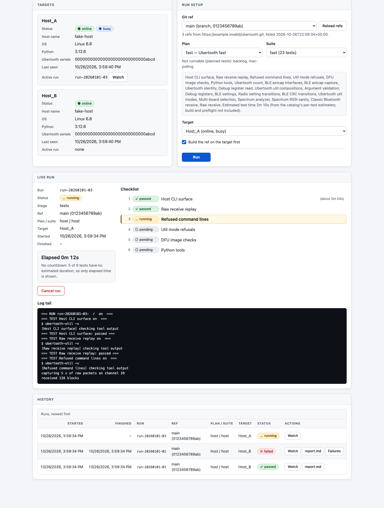

# Ubertooth Test Harness

Standalone test-harness application for
[`SqueakyFloors/ubertooth`](https://github.com/SqueakyFloors/ubertooth) and its
companion [libbtbb](https://github.com/SqueakyFloors/libbtbb) builds. The application is described in
[DESIGN.md](DESIGN.md). The first implemented slice is a local, sequential
firmware-flash reliability runner. The persistent [target runner](#target-runner-service)
dials the [controller](#controller), which listens on `127.0.0.1` only; remote
access is an SSH tunnel.

## Environment

The harness runs only in its own Python 3.12 virtual environment, never in a
system, user, or another application's interpreter. Create or update it with
one idempotent command, on macOS or Linux:

```sh
python3 bootstrap.py          # creates or updates .venv
. .venv/bin/activate          # or call .venv/bin/python explicitly
```

[`bootstrap.py`](bootstrap.py) uses only the standard library. It finds Python 3.12 (or use
`--python PATH`), fails with install instructions if 3.12 or its `venv`
support is missing (Ubuntu: `python3.12-venv`), creates `.venv` with a
harness marker file, and installs the pinned [`requirements.txt`](requirements.txt) with the new
environment's own interpreter, pip's virtualenv guard on, and the user site
disabled; then it runs `pip check`. Rerunning reuses the environment. It
refuses to modify an existing directory that lacks the marker, and
`--recreate` rebuilds only a marked harness environment. `--venv PATH` selects
another location.

`run-suite` and `build` refuse to start outside a bootstrapped harness
environment. Every run manifest (schema version 4)
records the Python version, implementation, executable and prefix, pip and
dependency versions, OS and release, and CPU architecture under
`environment`. Commands below assume the environment is active.

## Validate plans

```sh
python -m ubertooth_harness validate-plan testplans/slow.yaml
```

## Named tests and registered resources

Plans contain human-readable test names with direct arguments—never commands or
expected output:

```yaml
fast:
  - Host CLI surface:
      hosts: each

  - Ubertooth identity:
      hosts: [Host_Linux, Host_Mac]
      Ubertooth: default
```

The built-in catalog owns descriptions, accepted/default arguments, hardware
roles, exact argv, timeouts, and result checks. Every plan item must contain
exactly one known test name; unknown names, legacy `cmd/check` entries, unknown
arguments, and invalid values fail during load.

`hardware.yaml` is the ignored local resource registry; copy
[`hardware.example.yaml`](hardware.example.yaml) to start. Register every macOS/Linux computer as a
`Host`, then attach typed resources such as `UT_Linux0`, `DK_Linux0`, and
`Hub_Linux0`. Aliases are for humans—the explicit type, host attachment, and
stable serial/probe identity are authoritative. A host's `defaults` selects its
preferred Ubertooth so repeated reliability tests stay on one device.

Selection is deterministic: `default`, `each`, or an explicit resource alias.
Ambiguous `any` and random selection are rejected. Tests with multiple hardware
roles require explicit aliases; a future explicit `all pairs` policy will be
separate. Target-runner discovery is
reconciled as present/missing/unknown before execution and never silently
reassigns an alias.

### USB power controllers

The registry models the ordered [Acroname USBHub3+](https://acroname.com/store/s79-usbhub-3p) as a typed `USB power
controller` with a 32-bit serial identity, explicit driver, capabilities, and a
unique downstream port for each powered resource. The generic controller
contract snapshots power, data, VBUS voltage, and VBUS current. A simulated
driver supports development and restoration tests without hardware.

The [BrainStem](https://acroname.com/software/brainstem-development-kit) adapter is lazy and optional: no package dependency is installed
until the arriving hub and exact distributable version are validated. It
connects to one configured controller serial, reads the serial back, checks
every API error and write readback, and refuses all real power/data changes
unless armed (`run-suite --allow-power-changes`). Ports are restored
to their original state after success or failure.

The StarTech managed hub driver (`startech managed USB hub`) is validated on
the Linux lab host. It talks to the hub's built-in serial management controller
by its stable `/dev/serial/by-id` path, refuses unvalidated controller
firmware, checks every write against the controller's port-mask readback (the
full port mask), and is also unarmed by default. It opens the controller
exclusively, and any I/O error, timeout, or malformed reply closes the link.
Only ports 1-3 are switchable; port 4 carries the management controller and is
refused as a precaution. Only the factory-default password is supported. The
hub cannot measure VBUS or switch data separately, so snapshots report
voltage/current as unknown, and a port reading "off" is not proof of power-off.
It needs [`pyserial`](https://pyserial.readthedocs.io/) (pinned in [`requirements.txt`](requirements.txt)), imported lazily. Standard
hub power control ([`uhubctl`](https://github.com/mvp/uhubctl)) only changes the reported state on this hub and
does not cut power, so it must not be used.

Isolation is confirmed from USB enumeration instead (read-only sysfs scan in
[`ubertooth_harness/enumeration.py`](ubertooth_harness/enumeration.py)): the selected board must become the only
Ubertooth enumerated, and isolated boards that were enumerated beforehand must
come back after restoration. See [DESIGN.md, "Power-controller boundary"](DESIGN.md#power-controller-boundary), for
the exact rules and error precedence.

Plans requiring `exclusive Ubertooth: true` compile deterministic power-off
actions for every other registered Ubertooth on the host. Compilation fails if
an extra board lacks a valid controller mapping or per-port VBUS capability.
`run-suite` applies those actions only with `--allow-power-changes`; without
it, the run fails before anything executes. A host with only the selected
board registered switches nothing and needs no flag (see the read-only check
below). Each controller is built from its registry `driver` (`startech
managed USB hub` or Acroname BrainStem), so one run can mix switch types.
Only the StarTech path has been validated on hardware; the Acroname path is unit-tested with simulated controllers until its
hardware validation ([#8](https://github.com/SqueakyFloors/ubertooth-test-harness/issues/8)). The simulated driver is for unit tests only and is
refused unless a test injects its own enumerator. Serials come from the
registry identity (32 hex digits; placeholders are rejected). Enumeration
verification is Linux-only; other platforms fail closed. Before the run
directory is created, the harness checks the flag and serials, connects to and
closes each controller to read the ports it will switch (no port is changed),
and scans USB once: the selected board must be enumerated, no unregistered
Ubertooth may be attached, and a registered board whose port is already off and
that is not enumerated is refused, since a killed earlier run may have left it
off. Each isolated invocation emits `isolation_started`, `isolation_applied`
(with the original state of every switched port), `isolation_confirmed`,
`isolation_restored`, `isolation_returned`, and `isolation_finished` events.
Any isolation failure fails that test and, like any test failure, stops the
run. A restoration failure names every controller and port that could not be
restored. SIGINT, SIGTERM, and SIGHUP (for example, a dropped SSH session)
cancel the run and restore every port. A cancel that arrives before the other
boards are switched (including during the pre-switch enumeration wait) skips
the test without changing power; once boards are off, cancellation restores
them, waiting at most about 15 s for removal and return. An exclusive test on a
host with no other registered board compiles no power actions and gets a
read-only enumeration check instead ([#27](https://github.com/SqueakyFloors/ubertooth-test-harness/issues/27)): no controller is built or
connected and `--allow-power-changes` is not needed. Readiness is a single
USB scan before the run directory is created, with no settle tolerance: it
must show exactly the selected serial. Then, before the test's cases run, the
harness waits (up to the return deadline) for exactly the selected serial to
hold for the settle time; that tolerance applies to this pre-case wait only,
so a board that briefly re-enumerates or drops out does not fail the test. The
test fails before any case runs if, at the deadline, the enumeration still
shows any of these: an extra board (registered on another host or not
registered at all), an unidentified device such as a board in DFU, or no
selected board. The refusal names what was enumerated and how to clear it. A
cancel during this wait is seen at the next poll and the test is recorded as
canceled. The check records `isolation_started` (no actions,
`read_only: true`), `isolation_confirmed`, and `isolation_finished`, and the
run manifest marks the invocation `exclusive_ubertooth`. Like the rest of
enumeration it is Linux-only and fails closed elsewhere.

Restoration runs in-process, so if the harness itself is killed (SIGKILL, OOM,
host power loss) while boards are isolated, power the ports in the last
`isolation_applied` event back to their recorded original state by hand before
the next run (an exclusive run that would switch that port refuses to start
while the board is still off). StarTech: send `GP` to read the 8-hex-digit mask (least-significant byte
first, bit 0 = port 1), OR in the bits for those ports, and send `SP` + the
password padded to 8 characters + the new mask, each CR-terminated. For
example, with the factory password `pass`, if `GP` returns `09000000` (ports 1
and 4 set) and port 3 must come back, send `SPpass    0D000000`. Acroname:
enable the port's power through BrainStem. Exclusive host/hub ownership across concurrent harness runs is not
yet enforced ([#25](https://github.com/SqueakyFloors/ubertooth-test-harness/issues/25)).

[`testplans/exclusive.yaml`](testplans/exclusive.yaml) runs the `Exclusive Ubertooth topology` test, which
checks with no `-U` selector that the selected board answers `ubertooth-util
-s`/`-v` and that `ubertooth-btle -f` keeps running until its deadline (this
proves the tool opened the only board, not that it captured packets). The
capture is capped at 10 minutes, since every other board is off meanwhile:

```sh
python -m ubertooth_harness run-suite \
  --plan testplans/exclusive.yaml --suite exclusive \
  --hardware hardware.yaml --host Host_Linux \
  --ubertooth-source /path/to/ubertooth --ubertooth-ref main \
  --output runs --allow-power-changes
```

Validate syntax/catalog only:

```sh
python -m ubertooth_harness validate-plan testplans/fast.yaml
```

Compile against registered resources before execution:

```sh
python -m ubertooth_harness validate-plan testplans/fast.yaml \
  --hardware hardware.yaml --suite fast
```

Run currently implemented catalog-owned tests for one local host:

```sh
python -m ubertooth_harness run-suite \
  --plan testplans/fast.yaml --suite fast \
  --hardware hardware.yaml --host Host_Mac \
  --ubertooth-source /path/to/ubertooth --ubertooth-ref feature/my-change \
  --test "Ubertooth identity" --output runs
```

The generic sequencer executes `Host version`, `Help smoke`, grouped `Host CLI
surface`, `Ubertooth count`, and grouped `Ubertooth identity` command cases.
The host surface runs help/parser checks for all eleven always-built
executables and retains each tool's result. It also runs `-h` on the BlueZ-only
`ubertooth-scan` and `ubertooth-follow`, skipping (not failing) them where they
are not built, and checks the host version line from `ubertooth-util
--host-version` and from `-V` on `ubertooth-rx`, `ubertooth-tx`, and
`ubertooth-afh`. `Ubertooth count` checks that `ubertooth-util -N` equals the
registered Ubertooths on the host (the selected board plus its guards), so an
unregistered or missing board fails it. Because it uses guards, the fast and
release plans need every registered board attached and readable, like the
transition tests. The identity test runs isolated firmware, compile, serial, part, and
board queries plus the compatible `-vVspb` composition. `Debug register read`
constructs a serial-selected `ubertooth-debug` command from the normalized plan
register. Each case retains its own command, output, log, and result while the
parent YAML item reports one aggregate outcome. Remaining named tests are
catalog-validated and resource-planned but gain their hardcoded implementations
in subsequent slices.

`Host CLI surface`, `Raw receive replay`, `Refused command lines`,
`DFU image checks`, and `Python tools` need no Ubertooth, so `testplans/host.yaml` runs on a host with none registered or attached; a
registry holding just the `Host` entry is enough:

```sh
python -m ubertooth_harness run-suite --plan testplans/host.yaml --suite host \
  --hardware host-only.yaml --host Host_Mac \
  --ubertooth-source /path/to/ubertooth --ubertooth-ref main \
  --libbtbb-source /path/to/libbtbb --libbtbb-ref master --build --output runs
```

`Raw receive replay` writes its own synthetic `ubertooth-rx -i` input with
`ubertooth_harness/rxreplay.py` (spec sync words, HEC, whitening, and a DH1
CRC, so libbtbb derives a known UAP); no over-the-air capture is used or
stored.

`Refused command lines` runs every tool as `env UBERTOOTH_TEST_NO_DEVICES=1
<tool> ...`, so a command that got past its argument checks finds no board
instead of opening one (libubertooth, fork `b6d8ede`). Its first step reads
the bytes of the libubertooth beside the tool on `PATH` (never running a tool)
and skips the case when that library lacks the variable's name, or when the
tool is not built (`ubertooth-follow` needs BlueZ). Each case seeds files with
known contents in its own capture directory, refuses one command naming a new
file and one naming a seeded file, then checks that nothing was created,
truncated, or left behind (`ubertooth_harness/refusal.py`).

`DFU image checks` runs `ubertooth-dfu -d <image> -r` and `-s` the same way,
with the same skip. `-d` checks the whole image before it opens a device, so
each bad image must be refused with the image check's message before the board
lookup (no switch note, no DFU stage log) and leave its directory, the image
included, exactly as it was; a good image must get past the check to the
lookup, which finds no board. The host-only plan has no firmware build (CI has
no ARM toolchain), so the cases use a synthetic image (`dfuimage.py synth`:
filler with a `ubertooth harness-synthetic (` revision marker and the suffix
the harness computes) and derive the bad images from it as `DFU images` does
from the test build. `sign-test-build` signs the test build's binary and
compares the result with the build's `.dfu` when the run has one
(`--build --with-firmware`, or `--artifact "test build=PATH"`), and is skipped
with that reason otherwise.

`Python tools` runs `ubertooth-specan-ui -h` with no display (`DISPLAY`,
`WAYLAND_DISPLAY`, and `QT_QPA_PLATFORM` removed) from a
`--build --with-python` prefix, and `btle-extcap.py` (which CMake never
installs) exactly as it is in the resolved Ubertooth commit, read with
`git show`. specan-ui imports numpy, qtpy, and a Qt binding before it parses
`-h`, so its case is skipped, with the reason, when the run has no Python-tool
build or that interpreter lacks one of them. `BLE extcap interfaces` runs
`btle-extcap.py --extcap-interfaces`, which opens every attached board through
`ubertooth-util -s`, so it leases and guards them like `Ubertooth count`.
Both run through `ubertooth_harness/pytools.py`.

## Option compositions and stateful transitions

Stateful host CLIs need more than isolated option checks. Plans must select a
`coverage` profile for each transition test; the Python implementations own
every command, expected state, and cleanup step. [`testplans/fast.yaml`](testplans/fast.yaml) runs
`smoke`; [`testplans/release.yaml`](testplans/release.yaml) runs `comprehensive` plus the BLE mode
conflicts, before release preparation:

```sh
python -m ubertooth_harness validate-plan testplans/release.yaml \
  --hardware hardware.yaml --suite release
python -m ubertooth_harness run-suite \
  --plan testplans/release.yaml --suite release \
  --hardware hardware.yaml --host Host_Mac \
  --ubertooth-source /path/to/ubertooth --ubertooth-ref main --output runs
```

| Test | `smoke` (fast plan) | `comprehensive` (release plan) |
|------|---------------------|--------------------------------|
| `Ubertooth util compositions` | `-v -V` and every read-only report in one command | adds every other compatible read-only pair and repeated `-U` (last wins) |
| `Argument validation` | one rejected argument per tool (`util -c2401`, `btle -x33`, `ego -l0`, `ducky -A36`, `rx -u` without `-l`, `specan -l 2401`, and a stray word for `afh`, `debug`, `dfu`, `dump`, `tx`) | every rejected argument in `REJECTIONS` (64): out-of-range, non-numeric, or partly numeric `util -c -C -a -z -l -d -q` values, attached or as the next word (`-q` takes 20-120, so `-q19`, `-q121`, and `-q183` are refused), `util -z` with `-I`, `-q`, or `-x`, `-U all` with a setter or mode, bad advertising index, bad MAC/BD address, `-x33`, `-l0`/`-l49`, survey with an address, `specan` bad or reversed range, `btle -a zzzz` and `-v 2`; a stray word on every built tool (fork's one argument rule: after a set or a mode, a bare `-`, after `--`, a next word that is not a value such as `util -a 7x`) refused with `error: unexpected argument`; each must exit 1 with the tool's own error, start no mode, and leave channel, squelch, LEDs, PA, and CRC unchanged |
| `Radio setting transitions` | channel, PA level, squelch across an idle stop and an active-mode stop; `-c 2426` (value as the next word) and `-a0` (PA level 0) read back | adds USR LED; repeated `-c`, `-C`, `-a`, `-z`, `-l`, `-d` (last wins); mixed `-c`/`-C` in both orders; `-C`, `-a`, `-z`, `-l`, `-d` values and `-a 0` as the next word, and `-c -a -z -d -l` next-word values in one command, each read back; `-a9 -v` refused with exit 1 before the report; full reset `-r` from PA 0 returns boot defaults; a set and a read of the same value in one command (`-c<MHz> -c`, `-c -c<MHz>`, `-a<level> -a`, `-l<state> -l`, `-d<state> -d`) sets it and reports the new value (fork #228, fixed in 5b45b3e) |
| `BLE CRC transitions` | CRC enabled during `-n` and `-f` on channel 37; one `-n` capture per format (`-r` PCAPNG, `-q` PCAP, `-c` PPI) | both CRC values x both modes x channels 37/38/39; both CRC values x both modes x each capture format; repeated `-v` (last wins); `-v 1` and `-v 0` as the next word; repeated capture files `-r -r`, `-q -c`, `-c -q` (first wins, extra file never created); `-r` with `-q` and with `-c` (separate handles, both written) |
| `BLE settings` | set and read back the access address, attached and as the next word (`-a <address>`); set, mask, and clear the follow target | adds `ubertooth-util -r` resets the access address to 8e89bed6; `-x0`/`-x32`; `-a -v` reports both and `-azzzz` is rejected (fork #171, fixed in 09e9a46); stopping a bounded receive-only `-p` run resets LEDs, channel, and squelch (PA kept) |
| `Debug registers` | register list `0x02,0x01,0x00` in order, nothing changed | adds a range, a reversed range, `-v0`/`-v1`/`-v2` output, rejected `-r 0x100` and `-v3`; a successful read exits 0 (`-r 0x01` and the range fail on fork builds before #164's fix, 89afc1c) |
| `Spectrum analyzer` | one full-band sweep (`duration` long): every frequency 2402-2480 reported, none outside, int8 RSSI | adds narrow, single, and top-of-band ranges, `-g`, `-G`, `-v`, and `-d` (binary file checked by `specandump.py`); `-d -x.bin` writes the file `-x.bin`, not stdout (fork #231, fixed in 053363a); ranges after a different range report no stale samples (fork #173, fixed in 20bcf11); stopping a bounded run with `-S` turns the preset LEDs off and resets channel 2441 MHz and squelch -120, PA kept (fork #191, fixed in aa4f620) |
| `Classic Bluetooth receive` | `ubertooth-rx -z -t N` survey (exits 0 by itself, N = `duration` in whole seconds, no earlier than N-0.5 s, survey lines are piconet addresses); `-t N -r` PCAPNG with link type 255; `ubertooth-afh -t N` with no piconet in range says no packet arrived and exits 2 after about N s, printing no map (fork #187, 3b22c95) | adds `-t N` without `-z`; `-c 39` (every packet on channel 39); `-e 0` and `-e 4` (no packet over the limit); `-s` deprecation notice; `-q` PCAP (link type 255); repeated `-r` (first wins, extra file never created); `-d` (68-byte BR records, checked by `rxdump.py`); `afh -t N -e 2` (same exit 2); `afh -r` one map line per second; `afh` with an unknown `-U` exits 1 (fork #185, fixed in 219a5b0) |
| `Raw receive` | `ubertooth-dump -d` (68-byte records) and `-b -d` (401-byte bitstream records), checked by `rxdump.py` with at least 50 records per second; `ubertooth-ego -r -c 2440` runs until stopped | adds `dump -l`, `-l -c`, `-c -l` (the last modulation wins, read back from CC2400 MDMCTRL with `ubertooth-debug`); `ego -l 1`, `-l 48`, `-a 630f9ffe`; `ego -a zz` rejected; strict: five rounds of `dump -d` after `btle -n -A37` and `btle -n -A37 -q` after that dump, every stream bounded with SIGTERM, hold no packet from the previous mode, with the per-iteration stale count recorded (`stalecheck.py`; fork #318) |
| `Refused command lines` | no Ubertooth; `host` and `fast` plans, and CI: every file option (`btle -r -q -c`, `follow -r -q -d`, `rx -r -q -d`, `dump -d`, `specan -d`, `dfu -s -u`) refused by a stray word, `-h`, and a bad later value (`dump`: `-U` without its value) creates no file, leaves an existing one unchanged, and leaves no other file; the refusal comes before any board lookup; `Ignoring extra capture file` is on stderr (`btle -q - -q`, `rx -r -r`, `follow -q -q`); follow cases skip where it is not built | adds the checks after the option loop (`btle -f -n`, `-a -a<address>`, `-r -`; `rx -z -l`, `-u` without `-l`; `specan -l` above `-u`), `-d` twice with `-h`, and `dfu -u` with a missing `-s` input or a bad `-d` image (no temporary file); strict: `dfu -s <file.bin> -d <bad image>` writes no `.dfu` (fork #286) |
| `DFU image checks` | no Ubertooth; `host` and `fast` plans, and CI: the seven bad images of `DFU images` (wrong CRC, truncated, no suffix, text, no `UFD`, wrong vendor, wrong product), made from a synthetic image, are refused by `-d <image> -r` with the image check's message and exit 1 before any board lookup, the directory unchanged; the synthetic image passes the check and reaches the lookup; `-s` suffixes a binary exactly as the harness computes, accepts a read-only `.bin`, and refuses a `.dfu` and a suffixed `.bin` (nothing written); `-s` of the test build's binary gives the build's `.dfu` byte for byte when the run has a firmware build, else skipped | adds `-d` of an empty file, 15 bytes, a suffix with no firmware, a suffix length (200) larger than the file, DFU version 2.0, no revision marker, a directory and a missing file (all refused before the lookup), DFU 1.1 and the `ffff:ffff` wildcard (accepted), `-s` of a missing `.bin` and of a `.bin` with a wrong-CRC suffix; strict: `-s` of an input it cannot read (a directory) leaves an existing `.dfu` alone (fork #305) |
| `Python tools` | no Ubertooth; `host` and `fast` plans, and CI: `ubertooth-specan-ui -h` without a display shows its argparse usage (`-U`, `-l`, `-u`, `--wifi`, `--padding`), skipped without `--build --with-python` or numpy/qtpy/Qt; `btle-extcap.py -h` exits 0; `--extcap-dlts` lists DLT 256 (`DLT_BLUETOOTH_LE_LL_WITH_PHDR`); `--extcap-config` lists the `--channel` selector with 37 (default), 38, 39 | adds `--extcap-dlts` with no interface and `--extcap-config` with a non-Ubertooth interface (exit 1), an unknown option (exit 2, usage); strict: `-h` names the real options (fork #268) |
| `BLE extcap interfaces` | `btle-extcap.py --extcap-interfaces` lists one `ubertooth<N>` interface per attached board, `N` from 0, guards unchanged | strict: each line shows the board's serial; with two or more boards it shows `0:` (fork #269) |
| `Raw receive replay` | no Ubertooth; `host` and `fast` plans, and CI: `ubertooth-rx -i` on a synthetic fixture (`rxreplay.py`, built from the spec encoding, never a real capture) prints exactly the fixture's LAP/error/channel lines and skips the decoy records; `-l <LAP>` derives the UAP (CLK6 0); `-r` PCAPNG and `-q` PCAP with link type 255 and one packet per line | adds `-z` (both piconets, one with its UAP); `-l` of an ID-only LAP (no UAP); `-l -u` with the right UAP (confirmed, hop reversal) and a wrong one (nothing confirmed); `-e 0` drops the one-error access code; `-d` writes the packet records back byte for byte (and passes `rxdump.py`); `-l -q` captures one LAP; empty file exit 0; missing file exit 1; lines carry the recorded systime (fork #202); `-i <directory>` and a cut last record are reported, exit 1 (fork #203; both fixed in a55ac89); `-i -u` without `-l` refused before the input is used (fork #236, fixed in 57469f2; the bare `-u` is in Argument validation, under a lease) |
| `Ubertooth util modes` | `-I` blinks every LED, `-q120` (-120 dBm) lights every LED; each returns at once, keeps channel and PA, and `-S` ends it with the idle reset (LEDs off, 2441 MHz, squelch -120, PA kept); originals are restored; `-m` after `-r` says `no range test result yet` (fork #190) | adds `-q20` and bare `-q` (-85 dBm) running until `-S`, `-I` ending `-q` and `-q` ending `-I` (the new mode starts at 2441 MHz), `-s -I`. A failed LED read (fork #213) is retried once and the retry recorded; two in a row fail the case |
| `Multi-board selection` | needs two or more registered boards on the host (a one-board host skips it): `-U all -s` and `-s` without `-U` list every registered board and only those; `-N` counts them; each `-U<index>` opens the board the listing names at that index | adds `-U all -vVspb` and `-vVspb` without `-U` (five lines per board), `-C` without `-U` refused; `-U<n>` past the last board is refused with `no Ubertooth at index` (fork #188, fixed in 0c7e9c0) |
| `DFU images` | writes the selected board's firmware; slow plan (not fast): `-d <test image> -r`, then `-u -r` reads back the image padded with 0xff; `-s` on the image without its suffix gives the build's `.dfu` | `firmware` plan (not release): adds `-s` refusing a `.dfu`; seven bad images (wrong CRC, truncated, no suffix, text, no `UFD`, wrong vendor, wrong product) refused before a device is opened (fork #198, #199, fixed in e8edd15), the board still in its application with the same flash (read back); `-s` refuses a suffixed `.bin` and accepts a read-only one (fork #200, fixed in 9d710fe). At 6fee30c `-d <image> -r` exits 1 after a good flash (fork #267, fixed in 89d9197), so the write cases fail there |
| `BLE mode conflicts` | no `coverage` argument; release plan | every combination of `ubertooth-btle -f -n -p` must be rejected before sniffing |
| `Ubertooth util conflicts` | no `coverage` argument; requires `allow RF transmission: true`; release plan | every pair of `-q -n -e -t -x -I` must be rejected with the fork's `error: options ... cannot be combined` before a mode starts |

Every test case is built before the manifest is written or any command runs,
so an implementation error fails the run before it touches hardware. Every
state-changing case first stops the device so originals are read from
idle (if the board was left in an active mode, that stop has already reset
channel, squelch, and LEDs, so those post-stop values are the originals),
records every readable setting it or its modes can change, and always runs
cleanup: return to idle, restore each recorded original, verify each
restoration, and confirm the registered serial.

The setting cases check the firmware stop contract. A stop from idle changes
nothing. Stopping an active mode (the cases use `-x`) resets channel to
2441 MHz, squelch to -120, and LEDs to off; PA level is kept. CRC cases preset
the opposite value first, so a mode that loses its CRC setting cannot pass by
matching a leftover value; the CRC re-read after the mode is the check.

Capture cases write to `captures/<invocation>/<case>/` in the run directory
and check the file header with `ubertooth_harness/capturefile.py`, run by path:
`ubertooth-btle` `-r` PCAPNG and `-q` PCAP must have link type 256
(`LINKTYPE_BLUETOOTH_LE_LL_WITH_PHDR`), `-c` PCAP link type 192
(`LINKTYPE_PPI`). `ubertooth-rx` `-r` PCAPNG and `-q` PCAP must have link type
255 (`LINKTYPE_BLUETOOTH_BREDR_BB`). `ubertooth-dump -d` and `ubertooth-rx -d`
files are checked with `ubertooth_harness/rxdump.py` (record size, packet
type, channel index, host times), which prints only a record count. Only the
header is read; nothing from the packets is logged.
Capture files can hold nearby devices' traffic, so they stay in the run
directory and must never be committed. The receive tools' own output (the
`ubertooth-rx` packet lines with nearby LAPs) is logged like any other
command output.

Not checked or restored, because no option the cases use can read it: the
modulation (the firmware stop returns it to basic rate), the BR/EDR target
address and LE advertising channel (cleared by a mode stop), the BLE
follow target, and the E-GO capture length and access code (`Raw receive`
sets `ubertooth-ego -l1`/`-l48`/`-a`; a later `-l`/`-a` or `-r` replaces them).
The BLE access address (reset to 8e89bed6 by `-r`) is read with
`ubertooth-btle -a`: `BLE settings` records and restores it; other cases leave
it alone.

LEDs are recorded and restored as a USR/RX/TX triple. `-l` sets USR only and
`-d` sets all three, so a state with RX different from TX can be read but not
written back. Any case whose original for a setting it may change cannot be
written back (RX different from TX) is reported `skipped`
before anything changes; if a value turns out unrestorable after a change,
cleanup fails. Failure reasons name the output pattern that did not match. A continuous mode that
reaches its deadline reports `command_finished` status `stopped`.

`ubertooth-util -a0` (or `-a 0`) sets PA level 0, so every PA level can be
written back. That needs fork main 4ed4a1d or later; on older builds `-a0`
was a query and the PA-0 cases and the full-reset case fail. On hardware a
powered-on or reset board reports PA level 7 (checked on current main and the
2020-12-R1 firmware); the full-reset case sets PA 0 before `-r` and checks
that boot default, so a board found at PA 0 is covered too.

Option values follow the fork's one argument rule (8b58f75 for
`ubertooth-util`, 0b63b01 for the other tools): a value is attached or the next
word, a next word is taken only when it looks like a value (so `-c -b` is two
queries), and any leftover word is refused before a device is opened. A set and
a read of the same `ubertooth-util` value in one command both run, the set
first (`-c2426 -c` reports 2426; fork 5b45b3e,
[SqueakyFloors/ubertooth#228](https://github.com/SqueakyFloors/ubertooth/issues/228)). `test_finished` reports `failed_cases`,
`failed_guard_checks` (see [Guard Ubertooths](#guard-ubertooths)), and `skipped_cases`; the run summary (`run_finished` in run.jsonl, and
report.md) reports the run's `skipped_cases`, so a
skip is never hidden by an overall pass. Event schema version 1 is pre-release
and has no stable consumers yet; field changes before the controller lands do
not bump it.

A state-changing case stops at its first failed step. The parent test moves on
to the next case only when that case's cleanup verified the device restored;
otherwise the test stops. Cleanup runs with its own hard-timeout commands even
after cancellation or an internal error such as a failed event write, during
the transition or during cleanup itself (remaining restores run without
events, then the error is raised), a cleanup failure fails the case, and a passing cleanup
never clears an earlier failure. A case is reported `canceled` only when
cancellation was its sole failure. Restore steps that depend on a value never
recorded are reported as skipped when nothing was changed and as failed
otherwise. Every step that runs, is skipped, or is canceled before it starts
emits a `step_finished` event with its reason, expected and observed values,
and argv (`null` for a step that did not run). Steps after the first failure or
skip emit nothing. Aggregate reasons are bounded; each
case's full reason is in its own `check_finished` event.

`Ubertooth util conflicts` keeps its `allow RF transmission: true` guard:
fork main refuses every pair before a mode starts
([SqueakyFloors/ubertooth#82](https://github.com/SqueakyFloors/ubertooth/issues/82),
fixed by #134), but a regression that accepted a pair would start range test,
repeater, or TX test and transmit. It is in [`testplans/release.yaml`](testplans/release.yaml)
since a passing hardware run at fork 3b22c95.
The full-reset case can fail on macOS when re-enumeration takes longer than
the fixed 2 s wait inside `ubertooth-util -r`
([SqueakyFloors/ubertooth#94](https://github.com/SqueakyFloors/ubertooth/issues/94)).
Repeated `ubertooth-btle` options (capture files are first-wins) are tracked in
issue [#14](https://github.com/SqueakyFloors/ubertooth-test-harness/issues/14).
`ubertooth-util -i` and `-f` are excluded because an accepted conflict could
leave the board outside the application firmware. Against current firmware,
pairs that start range test, repeater, or TX test transmit on 2.4 GHz until
cleanup's stop, so the test requires `allow RF transmission: true`; PA level
and channel are recorded and restored. Pairs with `-I` never exit on their own
(identify handles only SIGINT) and run to the 5 s timeout before cleanup.

### Guard Ubertooths

Every test in the [table above](#option-compositions-and-stateful-transitions)
except `Raw receive replay`, `Refused command lines`, `DFU image checks`, and
`Python tools` (which open no Ubertooth), and
`Ubertooth count` and `BLE extcap interfaces`,
binds each other registered Ubertooth on the host as a `guard Ubertooth 1`,
`2`, ... resource of the same invocation, so the
[Results table, transcript](#run-output-runjsonl-and-reportmd), and manifest
name the guards. The design is in
[DESIGN.md, "Named test plan schema"](DESIGN.md#3b-named-test-plan-schema). A host with one
registered Ubertooth has no guards. Preflight checks each guard-only board's
serial (`ubertooth-util -U <serial> -s`) and that its firmware API (`-v`) is
no older than the host tools' API; a guard below it is refused before any
test. Its firmware revision is not required to match the resolved one. Guards do not count toward the
firmware-order check (a firmware-writing test must be the last test on its
board), so a guarded test may follow a flash on another board.

A guarded test therefore needs every registered Ubertooth on its host to be
attached, idle, and readable, each registered with its full 32-hex-digit
serial (libubertooth matches `-U` against the end of a serial). `run-suite`
refuses shorter serials for the selected host before any build or device
access. Planning stays permissive: `validate-plan --hardware` prints a
`warning:` line for each such invocation but still exits 0.

Before the first case the test records a baseline for each guard with
read-only queries only: `ubertooth-util -U <serial>` with `-v` (firmware
revision and API), `-V` (firmware compile info, whose build timestamp also
catches a reflash of the same revision), `-C` (channel), `-a` (PA level), `-z`
(squelch), and `-d` (LEDs), then `ubertooth-btle -U <serial> -v` (CRC).
`ubertooth-util` never checks the firmware API, but `ubertooth-btle` does, and
it sends a stop to firmware whose API is older than the host tools'
(`ubertooth_check_api` in the fork's
[`host/libubertooth/src/ubertooth.c`](https://github.com/SqueakyFloors/ubertooth/blob/main/host/libubertooth/src/ubertooth.c)).
So the CRC read runs only when the same check's `-v` read showed an API no
older than the host tools' (no host tool reports it, so the harness reads
`UBERTOOTH_API_VERSION` from the resolved Ubertooth source and refuses guarded
tests if it cannot). Otherwise the read is refused without running and the
baseline fails: the guard firmware API is too old to read CRC safely. The harness
never sets, stops, or resets a guard. One stop it cannot prevent: the fork's
`ubertooth_connect_serial` sends a stop when it cannot claim the board's USB
interface, so a guard held open by another process may receive one from any
read.

The same reads run after every state-changing case (`Guard Ubertooths
unchanged after <case>`) and, if read-only cases ran since the last check,
once after the test; each value must equal the guard's own baseline. Any
difference fails the test and stops it, even in a test that otherwise
continues past failed cases. Every read runs even after the first difference,
so the record shows each one. Without a baseline (a read failed) no case runs.
Guard checks after a case run with their own hard timeouts even after
cancellation, as cleanup does. Each guard read is a `step_finished` event with
stage `guard` and its expected and observed values, and each command is
recorded like any other. A guard that differs is never restored: the failure
reason names it (role, alias, and serial) so the operator can check and
restore it by hand. `test_finished` counts failed guard checks in
`failed_guard_checks`, not in `failed_cases`; the Results table shows them
beside the case count (for example `0 + 1 guard check`).

The check sees only what it reads. It catches a leaked firmware change or
reflash and any change to channel, PA level, squelch, LEDs, or CRC. On a guard
idle at boot defaults it cannot see a leaked `-S` or `-r`, or a mode start
(`-x`, `-t`, range test, repeater, `ubertooth-btle -n`/`-f`) that leaves those
values unchanged, so a guard could be left transmitting without the test
failing. Modulation, access address, and USB re-enumeration are not read.

## Building the resolved revision

By default a run tests the Ubertooth tools already installed, and preflight
refuses to start when they do not match the requested commit. With `--build`
the run builds the exact commits it tests instead:

```sh
python -m ubertooth_harness run-suite --plan testplans/fast.yaml --suite fast \
  --hardware hardware.yaml --host Host_Mac \
  --ubertooth-source /path/to/ubertooth --ubertooth-ref feature/my-change \
  --libbtbb-source /path/to/libbtbb --libbtbb-ref master \
  --build [--with-firmware] [--with-python[=PYTHON]] --output runs
```

The resolved commits are cloned into `<run>/build/src` (the source checkouts
are never modified), built out of tree, and installed into `<run>/build/prefix`.
Every test and preflight command then runs with that prefix first on `PATH`, so
the run tests what it built. Host tools use `-DREQUIRE_ALL=ON` on Linux (BlueZ
exists only there), with udev rules off and the Python tools off unless
`--with-python` is given. `--with-python` builds them (`-DENABLE_PYTHON=ON`)
for the named interpreter, `python3` on `PATH` by default, passed as
`-DPython3_EXECUTABLE` (a virtual environment's `python` is kept as given, so
its packages are used). The installed `ubertooth-specan-ui` and
`ubertooth-btbr` must name that interpreter on their first line, and the
manifest records its path and version. specan-ui itself needs numpy, qtpy, and
a Qt binding (PyQt5/6 or PySide2/6) in that interpreter. `--with-firmware`
also builds `bluetooth_rxtx.dfu` with the built `ubertooth-dfu`; the image is
hashed into the manifest, not flashed. The built `ubertooth-util -H` must
report both resolved revisions, without a modified-source `*`.

The manifest records the toolchain (CMake, C compiler, pkg-config, libusb,
BlueZ on Linux, the ARM compiler when building firmware, and the Python with
`--with-python`), the CMake flags,
every build command with its exit code, and hashes of every built tool,
library, and firmware image. Every host tool the catalog runs must be in the
prefix, so a missing one cannot fall through to an installed copy. The build
commands are recorded in run.jsonl and appear under `=== BUILD ===` in the
report. A missing tool or library stops
the run first, naming what to install. Ctrl-C cancels the build, and the
whole build has a one-hour deadline on top of per-command timeouts.

`python -m ubertooth_harness build` does the same build without running tests.

Install the build prerequisites and udev rules once per machine, for example
with the fork's [`install.sh`](https://github.com/SqueakyFloors/ubertooth/blob/main/install.sh). The harness never runs it or installs anything
system-wide.

## Source identity, manifest, and mandatory preflight

Every named-suite run requires `--ubertooth-source` and `--ubertooth-ref`. The
ref may name a branch, tag, or commit; the CLI resolves it without switching the
checkout and records the full immutable commit plus the repository and short
build revision. Dirty or untracked source content is rejected. Supply
`--libbtbb-source` and `--libbtbb-ref` together when validating an exact
companion build. Repeat `--artifact NAME=PATH` to hash build products into the
manifest.

Before preflight, the `manifest` record in run.jsonl captures the source revisions,
SHA-256 identities of the plan, hardware registry, supplied artifacts, and
immutable resource-bound invocations. The sequencer then generates mandatory
preflight from the selected resources; it does not depend on optional test-plan
entries:

- `Host version` once per selected host, matched to the resolved source commit;
- firmware version, compile identity, and registered serial once per selected
  Ubertooth, always selected by serial.

Checks are deduplicated by host/resource and emit normal check/command events.
Any mismatch prevents the first `test_started` event. This local slice verifies
artifacts that are already installed. Building and installing the resolved ref
on local/remote targets remains a later preparation phase; preflight cannot be
skipped to compensate for a missing installation.

## Sharing boards: leases

Several agents can share one host's Ubertooths when they run as the same user
account (leases live in that user's home; separate accounts do not exclude
each other, see [#12](https://github.com/SqueakyFloors/ubertooth-test-harness/issues/12)). `run-suite` leases
every board it touches before preflight and holds the leases until the run
ends: the selected board, guard and alternated boards, power-isolated boards,
and, for `Flash reliability` and exclusive tests, every Ubertooth on the host
(they read or enumerate all of them). A lease is an exclusive `flock` on
`~/.ubertooth-harness/leases/<serial>.lock` (override with
`UBERTOOTH_HARNESS_LEASE_DIR`); the kernel drops it when the process exits, so
leases never go stale. Boards are taken all or nothing, so two runs cannot
deadlock. A leased board needs its full 32-hex-digit serial in the hardware
registry: libubertooth matches `-U` against the end of a serial, so a short
serial would select the same board under a different lock.

If a board is held, the run fails before any build or device command and names
the holder. `--wait-for-boards MINUTES` waits instead; `--owner LABEL` (or
`UBERTOOTH_HARNESS_OWNER`) names you in other agents' errors. The run report
lists the leases.

```sh
ubertooth-harness boards --hardware hardware.yaml --host Host_Mac  # free / held by whom
ubertooth-harness lease --hardware hardware.yaml --owner "agent #14" UT_Mac0 -- \
    ubertooth-util -U <serial> -v                          # manual use, leased
```

`lease` holds the named boards for exactly as long as the command runs; the
command inherits the locks, so they stay held even if the harness process is
killed first. Use it for every manual Ubertooth command on a shared host.

## MAC polling workload soak

[`testplans/mac-polling.yaml`](testplans/mac-polling.yaml) contains one dedicated `MAC polling soak` item.
It reproduces the shape of a production-style MAC polling workload: a persistent
`ubertooth-btle -f` capture, five in-memory MAC buckets rotated every two
seconds, one-second lookup cadence, ten-second listener-silence detection, and
the existing empty-bucket/restart timing. The plan selects a registered Linux
host, its preferred Ubertooth, and a deterministic nRF52840 DK advertiser whose
BLE address is recorded in the resource registry. It also requires
`exclusive Ubertooth: true`: every other registered board on that host must be
physically power-controlled, leaving exactly one enumerated device before the
implementation runs the production command verbatim as `ubertooth-btle -f`
without `-U`.

The committed plan currently defines and resource-compiles this future soak;
its manifest includes every required power-off action, but its executable
implementation remains pending. Once implemented, `run-suite` [power isolation](#usb-power-controllers)
(above) will power down extras (or, with only one registered board, check
read-only that no other Ubertooth is attached), verify exactly one expected
no-selector serial, run the soak, and restore/read back all original states on
success, failure, or cancellation. Unknown or unpowerable extra Ubertooths
fail closed. The harness will model bucket rotation and MAC queries directly
in-process; it will not start the original workload or add a network listener.

Validate its catalog and resource bindings with:

```sh
python -m ubertooth_harness validate-plan testplans/mac-polling.yaml \
  --hardware hardware.yaml --suite mac-polling
```

## Run output: run.jsonl and report.md

A test that fails does not end the run when the device is back in a known
state: every failed case was verified restored and every guard read matched.
Later tests still run, the run fails, and its summary names the first failed
test and how many others failed. The run stops after a failed test only when
that state is not known: a case was not verified restored, a guard changed or
could not be read, a flash failed, power isolation failed, or the run was
canceled. A failed test's `test_finished` says which with `stops_run`. A
later cancellation does not hide an earlier failure: the run still fails.

A test run is one `run-suite` run of a plan suite. It writes exactly two files
into `<output>/<run-id>/` (plus `build/` with `--build`, and `captures/` when
a BLE capture case ran):

- `run.jsonl`: every record, appended and fsynced as it happens. The first
  records are `run_started` and `manifest` (sources, plan and registry hashes,
  artifacts, invocations, Python/OS environment, and build toolchain), then
  build commands, preflight, and each test's events, including every command
  and its output as it arrives. `run_finished` holds the summary.
- `report.md`: compiled from `run.jsonl` when the run ends, including failed or
  canceled runs. It lists the setup (commits, host and platform, toolchain,
  Python, device serials and firmware, artifact hashes) and a results table,
  then the full transcript.

Each transcript line starts with the time elapsed since the run started
(`HH:MM:SS.mmm`); the report header gives the run's UTC start time, and
run.jsonl keeps absolute UTC times (`2026-10-24T00:18:21.535`, no offset
suffix). Each line then carries a tag: `[C]` command sent (shell-quoted), `[O]`
stdout, `[E]` stderr, `[R]` command result (tool, exit code, duration, timeout
or cancellation), `[S]` state-change step, `[I]` power isolation, `[M]` harness
record. Section markers are indented to line up with the tagged text:
`+++ name +++` opens a step and `--- name EXIT: status ---` closes it; `===`
lines open and close the run, build, preflight, and each test:

```text
00:00:10.438     === PREFLIGHT ===
00:00:10.439     +++ Host version +++
00:00:10.439 [C] ubertooth-util -H
00:00:10.465 [R] ubertooth-util exit 0 in 0.025s; [O] libubertooth 1.1 (git-be97109), libbtbb 1.0 (git-f0fe176)
00:00:10.465     --- Host version EXIT: passed ---
00:00:10.466     === PREFLIGHT EXIT: passed ===
00:00:10.466     === TEST 002-Host CLI surface: Host CLI surface on Host_Mac ===
...
00:00:12.785     === RUN passed ===
```

A command that printed one line is two lines, with the response on the `[R]`
line. Longer output stamps each `[O]`/`[E]` line when it arrived, in arrival
order, before the `[R]` line. Very long output is capped in the report; the
rest stays in run.jsonl. The live terminal stream on stderr uses the same
`[C]`/`[O]`/`[E]`/`[R]` command tags.

Run IDs look like `20261022T203045Z-a1b2c3d4e5f6`; `--run-id` supplies a
path-safe ID. Records use event schema version 1 (pre-release; no stable
consumers yet) and carry the run ID, UTC timestamp, sequence, status, and
bounded JSON details. The same records feed the live terminal stream on stderr
(stdout holds only the final summary JSON) and a future GUI; a live display
failure never interrupts hardware work.

SIGINT/SIGTERM (and SIGHUP) request cooperative cancellation. A firmware write
in progress is allowed to finish and be verified before the next one is
stopped; other commands are terminated as a process group.

Commands carry no credentials today. Before adding one that does, redact argv
and output where events are created; masking only in a display is not enough
because run.jsonl and report.md are persisted.

### Reports for several runs

```sh
python -m ubertooth_harness report runs/<mac-run-id> runs/<linux-run-id> \
  --title "Ubertooth 2026-11-R1 validation" --output validation.md
```

`report` writes one page summarizing each run's setup and results, for example
macOS and Linux runs for a release; each run's own report.md keeps its full
transcript. Serial numbers are shown; `--redact-serials` replaces them with
`<serial>`.

## Flash reliability

`Flash reliability` is an ordinary plan test (see [`testplans/slow.yaml`](testplans/slow.yaml)):

```yaml
- Flash reliability:
    hosts: each
    platforms: [macos, linux]
    Ubertooth: default
    flashes: 100
    image sequence: [test build, KGV]
    KGV sha256: e3fcb486c6e0ce7cc991bf6439f6dbc0156ed1229c2b95ebfd02198f9675bb11
    KGV revision: 2020-12-R1
```

Supply the images as artifacts named after the plan's image labels, for example
`--artifact "test build=/path/to/bluetooth_rxtx.dfu" --artifact "KGV=/path/to/kgv.dfu"`
with `--test "Flash reliability"`. With `--build --with-firmware` the freshly
built `bluetooth_rxtx.dfu` is the test build. The test build must report the
resolved Ubertooth revision; the KGV must match the plan's sha256 and revision.

The test:

- checks every image's SHA-256 (against the manifest and the pinned KGV) before
  the run starts and again before each write;
- alternates the images so every write changes the expected revision;
- flashes with `ubertooth-dfu` by serial, one write at a time;
- reads `ubertooth-util -v` after every flash and fails on any mismatch;
- reads every other registered Ubertooth on the host before the run and after
  every flash, and fails if one changes or disappears;
- applies a 25 s per-flash and a whole-test deadline and stops at the first failure.

Add `alternate Ubertooths: true` to rotate flashes across every registered
Ubertooth on the host. The planner binds the other boards (in alias order) as
`alternated Ubertooth 2`, `3`, ... resources of the same invocation, so
preflight checks each one's serial, the manifest records them, and the
"last test on its device" rule covers every board written. Flash 1 goes to
the selected board, flash 2 to the next, and so on. Each board alternates
between the test build and KGV, starting with the first image it is not running, so
boards that start on different images get different images in the same round,
and a board's final image depends on whether its own flash count is even.
`flashes` is the total across boards and must divide evenly by the board count
(for example, 100 flashes on two boards gives each 50). The step must list its
hosts (`hosts: [Host_Linux]`, not `each`), because planning covers every
selected host and one host that cannot alternate would stop the run
everywhere; `validate-plan` reports this without a registry. Planning refuses `Ubertooth: each` with `alternate Ubertooths` (it
would rotate once per board), a host with only one registered Ubertooth, and
any board without a full 32-hex-digit serial. Every registered Ubertooth on
the host is written, including boards the plan does not otherwise use. After every flash the target is read back and every
other board must still report the revision it had when last verified. The
report names the board for each flash and the per-board count, and
`flash_run_finished` carries `serials`, `verified_flashes_by_serial`, and
`final_revisions`: the last revision read from each board, `""` when a failed
write or unreadable output left it unknown, and absent for a board never
queried. `final_revision` stays the last verified revision of the selected
board.

Device selectors are serials: libubertooth treats an all-digit `-U` value as a
USB index and matches anything else as the end of a serial (first board wins),
so the flash test refuses digit-only selectors and any serial that is the
ending of another. Register full 32-hex-digit serials.

Because the test writes the firmware it verifies, preflight checks only its
Ubertooth's serial, not its firmware revision. It must be the last test on that
Ubertooth in the suite, so no later test runs on firmware the run did not verify.

## DFU images

`DFU images` covers `ubertooth-dfu` beyond the write path: `-s` suffixing,
`-u` read-back, and refusal of bad images. It writes the selected board's
firmware, so, like `Flash reliability`, preflight checks only that board's
serial and the test must be the last on its board. Smoke runs in
[`testplans/slow.yaml`](testplans/slow.yaml); comprehensive is the whole
[`testplans/firmware.yaml`](testplans/firmware.yaml). It needs the test image,
`--artifact "test build=/path/to/bluetooth_rxtx.dfu"` or `--build
--with-firmware`, which must report the resolved Ubertooth revision:

```sh
python -m ubertooth_harness run-suite --plan testplans/firmware.yaml --suite firmware \
  --hardware hardware.yaml --host Host_Mac \
  --ubertooth-source /path/to/ubertooth --ubertooth-ref main \
  --artifact "test build=/path/to/bluetooth_rxtx.dfu" --build --output runs
```

The first case writes the test image with `-d -r` and reads it back; every
later case starts from it. Files the cases make (a binary, bad images,
read-backs) go in the run's `captures/` directory; `dfuimage.py` checks them
and prints summaries only. Every bad image is followed by a read-back: the
flash must still hold the test image. After each case the cleanup reads the
flash back, rewrites the test image only if it differs, and checks the
revision, so a failed case leaves the board on the test image and the run goes
on. A board left in the DFU bootloader (fork #198, before e8edd15) has no serial; the cleanup
returns it only when exactly one DFU device is attached and every other
registered board answers in its application, using `ubertooth-dfu -u <file> -r`
without `-U`, which writes nothing. Otherwise the run stops for recovery by
hand. A read-back can fail and leave the board in DFU (fork #208): in a case
step that fails the case and the cleanup returns the board; in the cleanup it
returns the board but fails the cleanup, so the run stops. Other registered boards are guards, read before and after every case.

## Target runner service

`python -m ubertooth_harness runner` is the persistent target runner. It dials
the controller (outbound only; it opens no listening socket), registers, sends
heartbeats, and runs the suites the controller requests through the same
`run-suite` path, one run at a time:

```sh
python -m ubertooth_harness runner \
  --controller ws://127.0.0.1:8765/ws/runner \
  --hardware hardware.yaml --host Host_Mac \
  --ubertooth-source /path/to/ubertooth \
  [--libbtbb-source /path/to/libbtbb --libbtbb-ref master] \
  [--plans-dir testplans] [--allow-power-changes] \
  --output runs
```

The controller URL must be `ws://` or `wss://` with a loopback host
(`127.0.0.1`, `::1`, or `localhost` when every address it resolves to is
loopback). Any other host is refused at startup and there is no override:
remote runner authentication is still an open design item (see
[Networking status](#networking-status)). URLs with credentials are refused.
The runner connects to the checked loopback address itself, ignores proxy
settings, and follows no HTTP redirects.

On every connection the runner sends `register` with its registry host, host
name, OS identity, Python version, and attached Ubertooth serials, read from
sysfs the same read-only way power isolation does (no device is opened, so no
stop is sent; on macOS the serials are `null` with an `enumeration_error`).
A `run` request names a git ref (resolved in `--ubertooth-source`), a plan in
`--plans-dir` (`fast` is `testplans/fast.yaml`), a suite, optional exact test
names, and whether to `--build`. The runner starts `run-suite` in this harness
environment with a new run ID, answers `run_accepted`, and forwards every
run.jsonl record unchanged as an `event` message as it is written, then
`run_finished` (the run's own status and exit code) or `run_error` (the run
ended without a `run_finished` record, for example an unresolvable ref). The
run directory (run.jsonl, report.md) stays the source of truth. A second
`run` while one is active gets `run_rejected`. `cancel` sends the run SIGINT,
which run-suite turns into its normal cooperative cancellation, including
restoration of isolated boards. `--allow-power-changes` is a runner flag only;
the controller cannot arm power switching.

If the controller goes away the run continues. The runner reconnects with
exponential backoff (0.5 s doubling to at most 30 s), registers again with
`active_run_id` set, and replays the active run's events from the start of
run.jsonl, so the controller deduplicates by `(run_id, sequence)`. SIGINT,
SIGTERM, or SIGHUP stops the runner after cancelling and waiting for an
active run.

Messages are JSON objects with `"version": 1` and a `type`; each type has an
exact field set, and anything else (unknown version or type, a missing or
extra field, a wrong value) gets `protocol_error` and is not acted on. The
schema is in [`ubertooth_harness/protocol.py`](ubertooth_harness/protocol.py)
and [DESIGN.md section 2](DESIGN.md#2-target-runner-protocol-controller--target-runner).

## Controller

`python -m ubertooth_harness controller` is the controller: it keeps the target
registry, dispatches runs to target runners, stores their results, and streams
live updates for the GUI. It listens on `127.0.0.1` only. There is no `--host`
option or environment override (`--host`, `UVICORN_HOST` and similar are
refused), and there is no authentication: remote authentication is still an
open design item (see [Networking status](#networking-status)), so access
from another machine is an SSH tunnel.

Trust boundary: loopback-only is not access control. Every local user and
process on the controller host can call the whole API (start and cancel runs,
read results) and can register as a runner for any target name. With the
`ssh -R` forward below, the same holds for every local user and process on that
target. There is no authentication yet ([DESIGN.md section
8](DESIGN.md#8-decisions-and-open-items)); run the controller and runners only
on hosts whose local users you trust. A registration for a host that is
already connected replaces the old connection (so a runner whose previous
connection is half-open can reconnect); the controller logs a warning when the
replaced connection was still online.

```sh
python -m ubertooth_harness controller --port 8765 \
  [--results-dir ~/.local/share/ubertooth-harness/controller/runs] \
  [--ubertooth-repo https://github.com/SqueakyFloors/ubertooth.git] \
  [--plans-dir testplans]
```

`--ubertooth-repo` is the repository whose branches and tags the GUI offers
(listed with `git ls-remote`, cached for 60 s; no token is needed for a public
repository). It defaults to the public fork, the same repository CI builds. A
run may only name a ref from that list (or `HEAD`) or a full commit ID;
anything else is refused with 422 before the runner is asked. If the list
cannot be fetched (for example an offline lab), the ref is passed to the
runner unchecked and the controller logs a warning. The ref is still resolved in the runner's
`--ubertooth-source` checkout, so keep that checkout fetched. `--plans-dir`
is the directory of plans the GUI lists (default `testplans/`).

Start a runner on the same machine against it:

```sh
python -m ubertooth_harness runner \
  --controller ws://127.0.0.1:8765/ws/runner \
  --hardware hardware.yaml --host Host_Linux \
  --ubertooth-source /path/to/ubertooth --output runs
```

Tunnels (the controller checks the `Host` header, so keep the same port number
on both ends):

```sh
# Browser or curl on a laptop -> controller on the lab server.
ssh -N -L 8765:127.0.0.1:8765 lab-server
curl http://127.0.0.1:8765/api/targets
# Then open http://127.0.0.1:8765/ui/ in the laptop's browser.

# Runner on another target -> controller on the lab server. Run this on the
# lab server; the forwarded port binds only the target's loopback (sshd's
# default GatewayPorts no), and the runner there dials
# ws://127.0.0.1:8765/ws/runner.
ssh -N -R 8765:127.0.0.1:8765 target-host
```

### Web GUI

Open `http://127.0.0.1:8765/ui/` (through the tunnel above when the
controller is on another machine; a browser that asks `GET /` for HTML is
sent there). It is three static files in `ubertooth_harness/web/` (vanilla
JavaScript, no build step, nothing loaded from another site) and uses only the
REST and `/ws/live` endpoints below.



- **Targets:** one card per registered target: host, host name, OS, Python,
  Ubertooth serials (or why they are unknown), online/offline, last seen, and
  the active run with a Watch button.
- **Run setup:** git ref (default branch, branches and tags from
  `/api/refs`), plan and suite (from `/api/plans`, with the suite's tests),
  target, and whether to build the ref first; Run starts the whole suite.
- **Live run:** the suite's tests as a checklist that ticks from the run's
  events (✓ passed, ✗ failed, … running, ○ pending or not run; always text
  plus symbol), the current stage (building, preflight, tests), elapsed time,
  a Cancel button, and the last 200 log lines. A countdown is shown only when
  every test in the suite has an estimate. The catalog has no duration
  estimates of its own, so a test's estimate is its `duration` argument (for
  example `BLE monitor` with `duration: 10s`), and build and preflight time
  are not included: the countdown starts with the first test. Otherwise the view shows elapsed time and says why. The
  view is linkable as `/ui/#run=<run_id>`.
- **History:** every run, newest first, with started/finished times, ref,
  plan/suite, target and status, a link to its `report.md`, and for a run
  that did not pass a failure summary (each failed phase or test with its
  reason and last output lines, then the run's own reason).

Every HTTP response carries `Content-Security-Policy: default-src 'self';
script-src 'self'; style-src 'self'; connect-src 'self' ws://<host>;
frame-ancestors 'none'; ...` (no inline script or style),
`X-Content-Type-Options: nosniff`, `X-Frame-Options: DENY`,
`Referrer-Policy: no-referrer` and `Cache-Control: no-store`. The page inserts
controller and runner text only as text, never as HTML. Static files are
served from memory by exact name, so no request path reaches the filesystem.

Endpoints (JSON unless noted; `GET /` lists them):

| Endpoint | |
|---|---|
| `GET /ui/` | the web GUI (HTML, `app.js`, `app.css`) |
| `GET /api/refs` | `{"repository", "refs": [{"name", "kind", "commit"}], "fetched_at"}` from `git ls-remote` (`kind` is `default`, `branch` or `tag`); 503 if it cannot be listed |
| `GET /api/plans` | every `<plan>.yaml` in `--plans-dir` with its suites, test names, per-test `estimated_s` (from the `duration` argument, else null) and the suite total when every test has one; a plan that does not load is listed with its `error` |
| `GET /api/targets`, `GET /api/targets/{host}` | registry: host, hostname, OS, Python, Ubertooth serials, last heartbeat, `online`/`offline`, connected, active run |
| `POST /api/targets/{host}/runs` | start a run with the protocol `run` fields: `{"ref", "plan", "suite", "tests": [], "build": false}`; 201 with the run, 409 busy, offline, or rejected by the runner, 422 invalid or a ref not in `/api/refs` (full commit IDs are accepted), 504 no answer |
| `GET /api/runs[?target=HOST]` | runs, newest first |
| `GET /api/runs/{run_id}` | status, every event, and the failure summary (`failures`) |
| `GET /api/runs/{run_id}/report.md` | the run's report (Markdown) |
| `POST /api/runs/{run_id}/cancel` | `{"reason": ""}`; 202 once the runner accepts |
| `WS /ws/live[?run_id=ID]` | browser stream: a `snapshot`, then `target` and `run` updates, plus that run's `event` records |
| `WS /ws/runner` | target runner protocol v1 |

Every request and WebSocket handshake must carry `Host: 127.0.0.1:PORT` or
`localhost:PORT` and, if it has an `Origin`, that same origin (runner
connections must have none); `POST` bodies must be `application/json`.
Anything else gets 403, so a web page on another site or a DNS-rebound name
cannot drive the controller through a local browser.

Runner messages are decoded strictly (up to 4 MiB, enough for a 1 MiB
manifest record); a malformed or out-of-place message is counted on the
target and ignored, and a first message that is not a valid `register`
closes the connection. A target is `offline` after three heartbeat intervals
without a valid message, and runs cannot be started on it: only a message that
decodes as protocol v1 resets the offline timer, and malformed messages do
not. The controller allows one
outstanding start request per target and refuses a target whose runner reports
an active run. Each run is a flat directory `<results dir>/<run_id>/` with
`run.json` (the controller's record: target, request, status, exit code),
`run.jsonl` (the runner's records, deduplicated by `(run_id, sequence)` across
reconnects and controller restarts), and `report.md`, compiled from that
run.jsonl when the run ends. The default results directory is
`$XDG_DATA_HOME/ubertooth-harness/controller/runs` (else
`~/.local/share/...`), outside the repository. A run still executing when the
controller restarts is picked up again when its runner reconnects. A stored run
that is still `running` becomes `lost` (with a `reason`) when its target
registers without naming it as `active_run_id`, because the runner restarted or
now runs something else; runs loaded at controller startup stay `running`
until their target registers. A record that arrives after a run ended is
stored and `report.md` is rebuilt. Malformed lines in a stored run.jsonl are
skipped and counted (`malformed_lines`). A run or cancel request whose callers
all timed out (504) is kept for a grace period (60 s) so a late answer still
takes effect, then dropped. Overlapping cancels of one run share the
outstanding request, and each caller has its own timeout.

## Deploy on the lab host

Single-node deploy: the controller and one runner run as systemd user services
of the account that owns the checkout (no sudo needed), the GUI is opened from
the desktop or through a tunnel. The scripts touch only the checkout's
`.venv`, the harness data directory, the two user units, and the desktop
launcher. Linux with systemd only for now; on macOS
`deploy.sh` stops with an error (launchd is not supported yet).

As the service user, from a clone of this repository (`git pull` it to
update), with `hardware.yaml` describing the host:

```sh
scripts/deploy.sh --runner-host Host_Linux --ubertooth-source ~/ubertooth
```

It runs `python3 bootstrap.py`, writes `ubertooth-harness-controller.service`
and `ubertooth-harness-runner.service` to `~/.config/systemd/user/`, then
`systemctl --user daemon-reload` and `enable --now`, and prints their status
and the GUI URL. The controller runs `.venv/bin/python -m ubertooth_harness
controller` on `127.0.0.1:8765` (`--port N` to change it) with results in
`${XDG_DATA_HOME:-~/.local/share}/ubertooth-harness/controller/runs`; the
runner (`After=`/`Wants=` the controller) dials
`ws://127.0.0.1:PORT/ws/runner` and writes its run directories to
`.../ubertooth-harness/runner/runs`. Both have `Restart=on-failure`. Options:

| Option | |
|---|---|
| `--runner-host NAME` | registry Host resource of this machine (required) |
| `--ubertooth-source DIR` | Ubertooth checkout the runner resolves refs in (required; keep it fetched) |
| `--hardware FILE` | resource registry (default `hardware.yaml` in the checkout) |
| `--plans-dir DIR` | plans for the GUI and the runner (default `testplans/`) |
| `--ubertooth-repo URL` | repository whose refs the GUI offers (default the public fork) |
| `--libbtbb-source DIR`, `--libbtbb-ref REF`, `--allow-power-changes` | passed to the runner |
| `--port N` | controller port on `127.0.0.1` (default 8765) |
| `--no-start` | write the units (and daemon-reload) only |
| `--uninstall` | stop, disable and remove the two units only; the venv and results stay |
| `--force` | restart even while a run is active (cancels it) |
| `--dry-run` | print what it would do, change nothing |

Rerunning with the same options changes nothing. A unit is rewritten, and its
service restarted, only when its content changes; the units record the
checkout's commit, so a deploy after `git pull` restarts both. Uncommitted
edits and dependency updates alone do not change the units; restart by hand
after those (`systemctl --user restart ubertooth-harness-controller.service
ubertooth-harness-runner.service`). Restarting either service cancels an
active run (cleanly, restoring its boards), so a deploy that would restart
them refuses while the controller reports an active run; `--force` restarts
anyway.

User services stop when the user's last session ends unless systemd linger
is on. `deploy.sh` checks `loginctl show-user $USER -p Linger` and, when it is
`no`, prints the one-time command for an administrator; it never runs sudo
itself:

```sh
sudo loginctl enable-linger <user>
```

**Desktop shortcut.** On the lab host's own desktop, run as the desktop
(auto-login) user, not the service user:

```sh
scripts/install-desktop-shortcut.sh [--port 8765]   # --uninstall removes it
```

It writes `~/.local/share/applications/ubertooth-harness.desktop` (and a copy
on `~/Desktop` when that exists, marked trusted with `gio`) that runs
`xdg-open http://127.0.0.1:PORT/ui/`. The controller is on the machine's
loopback, so any local user's browser reaches it (see the trust boundary in
[Controller](#controller)). The script is self-contained; copy it if the
desktop user cannot read the service user's checkout.

**From a laptop.** `scripts/harness-open` (macOS or Linux) opens the tunnel,
waits until it answers, opens the GUI in the browser, and keeps the tunnel in
the foreground until Ctrl-C:

```sh
export HARNESS_HOST=lab-host.example HARNESS_JUMP=jump-host.example
scripts/harness-open                     # ssh -J $HARNESS_JUMP $HARNESS_HOST
scripts/harness-open --two-hop           # ssh the jump host, then the lab host
scripts/harness-open --host lab2 --jump bastion --port 8765 --dry-run
```

No host is built in: `--host`, `HARNESS_HOST`, or `HARNESS_HOST=...` in a
private config file names the lab host, and `--jump` / `HARNESS_JUMP` /
`HARNESS_JUMP=...` the jump host (unset or empty means a direct connection).
`HARNESS_PORT` sets the default port. An option wins over the environment,
which wins over the file; with no host the script stops and says how to set
one. An empty `HARNESS_JUMP` is a choice (no jump host) and wins, while an
empty `HARNESS_HOST` or `HARNESS_PORT` falls through to the file.

The config file is `$HARNESS_OPEN_CONFIG`, by default
`$XDG_CONFIG_HOME/ubertooth-harness/harness-open.conf` (so
`~/.config/ubertooth-harness/harness-open.conf` unless `XDG_CONFIG_HOME` is
set), outside the checkout and never committed. It is sourced as shell, so it
must be owned by you and not writable by anyone else; the script refuses it
otherwise, and reports a file that fails rather than exiting silently.

The forward is `-L 127.0.0.1:LOCAL:127.0.0.1:PORT` on every hop: it binds
only the laptop's loopback and reaches only the controller's loopback listener
(no `-g`, no `GatewayPorts`). When a jump host is set, it relays the
connection (`-J`). Use `--two-hop` when the jump host refuses that
("administratively prohibited" or "stdio forwarding failed") or when the lab
host's name is known
only to the jump host's SSH configuration. It relays through a Unix socket on
the jump host that only your account there can open (mode 0600, default
`/tmp/ubertooth-harness-USER-PORT.sock`, `--jump-socket` to pick another),
not a TCP port: the controller has no authentication, so a loopback port on
a shared jump host would let every user there drive it. Keep
`--local-port` equal to `--port`: the controller accepts only
`Host: 127.0.0.1:PORT`.

**Screen sharing** of the lab host's desktop (for example GNOME Remote
Desktop or VNC, itself through an SSH tunnel) is an alternative when a browser
on the lab host is easier than a tunnel; it needs no harness changes.

## Tests

[`COVERAGE.md`](COVERAGE.md) lists every Ubertooth host CLI option, which
named test covers it, the option combinations still to test, and what is hard
to test. Use it to pick the next test.

```sh
python -m unittest discover -s tests -v
```

CI runs the suite and validates the long plan with Python 3.12 on Ubuntu 24.04
and the current macOS (`macos-latest`; see `.github/workflows/test.yml`). The
build job also builds the fork's host tools, with the Python tools, and runs
`testplans/host.yaml` (Host CLI surface, Raw receive replay, Refused command
lines, and Python tools smoke, which need no Ubertooth; specan-ui is skipped there) with
them against a one-host registry. The
checks themselves are in `scripts/ci.sh`. To run them on an exact commit
without GitHub Actions, locally or on another host over SSH:

```sh
scripts/local-ci.sh                       # HEAD, this host
scripts/local-ci.sh -r <sha> -s "ssh lab-host.example"
```

The target-runner tests run against an in-process stub controller, and the
controller tests against scripted runners and the real runner, all on
`127.0.0.1` ephemeral ports with no hardware. The GUI tests check the served
page, assets and security headers, path traversal, the refs and plans
endpoints (with a scripted `git ls-remote`, plus the real git against a local
repository), ref validation, and statically that the page wires to the
expected endpoints and has no HTML injection sinks; there is no browser
automation. The deploy-script tests run `scripts/deploy.sh`,
`install-desktop-shortcut.sh` and `harness-open` against a temporary home with
fake `systemctl`, `loginctl`, `ssh` and browser commands (no systemd or
network), plus `bash -n` and, when installed, `shellcheck`. Provisioning, soak execution, and radio fixtures remain later
slices.

## Repository boundary

This repository owns the controller/GUI, target runners, test plans,
provisioning, private lab adapters, and result formats. Product host/firmware
code and deterministic C tests remain in the Ubertooth repository. Runs consume
explicit Ubertooth/libbtbb repository URLs and refs plus pinned firmware
artifacts; the harness does not import private product implementation details.

This repository is public. Keep lab- and device-specific integration details
(endpoints, credentials) in private lab configuration, and do not commit
credentials or captured device traffic.

## Networking status

The only listener is the controller, on `127.0.0.1`; the target runner only
dials a loopback controller, and remote use goes through SSH tunnels. Before
binding beyond loopback or connecting remote runners directly, define and approve the HTTPS, browser authentication, target-runner
authentication, outbound
connection, reconnect, and authorization contract. Do not use the provisional
shared-token text in [`DESIGN.md`](DESIGN.md#8-decisions-and-open-items) as production authorization.

## License

GPLv2; see [COPYING](COPYING).
