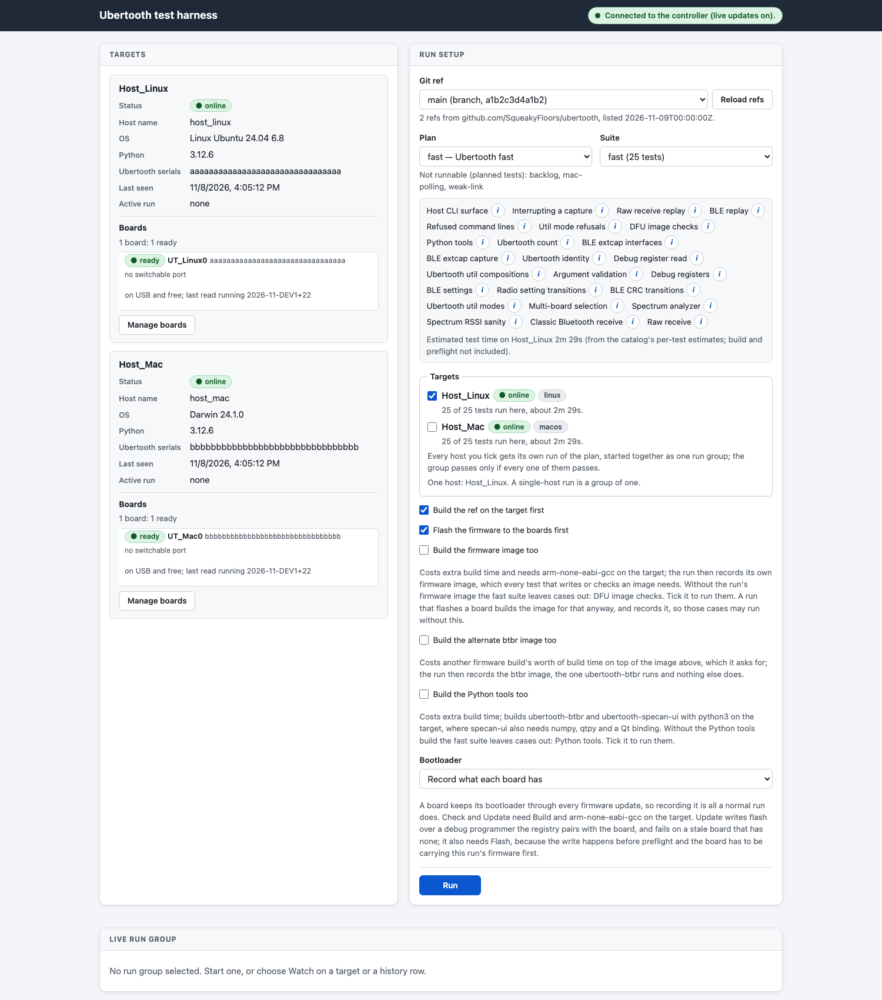
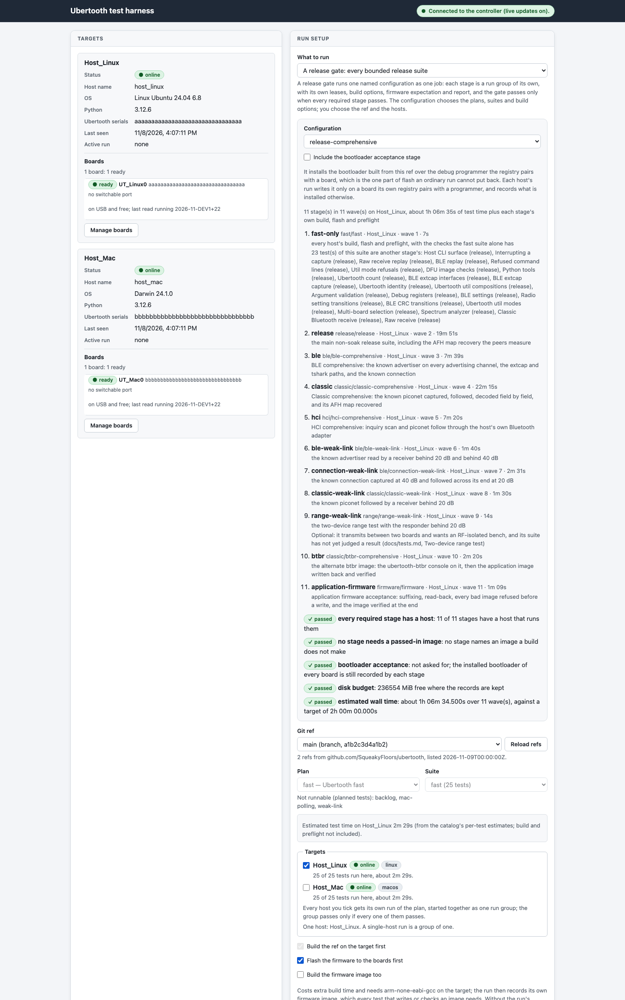
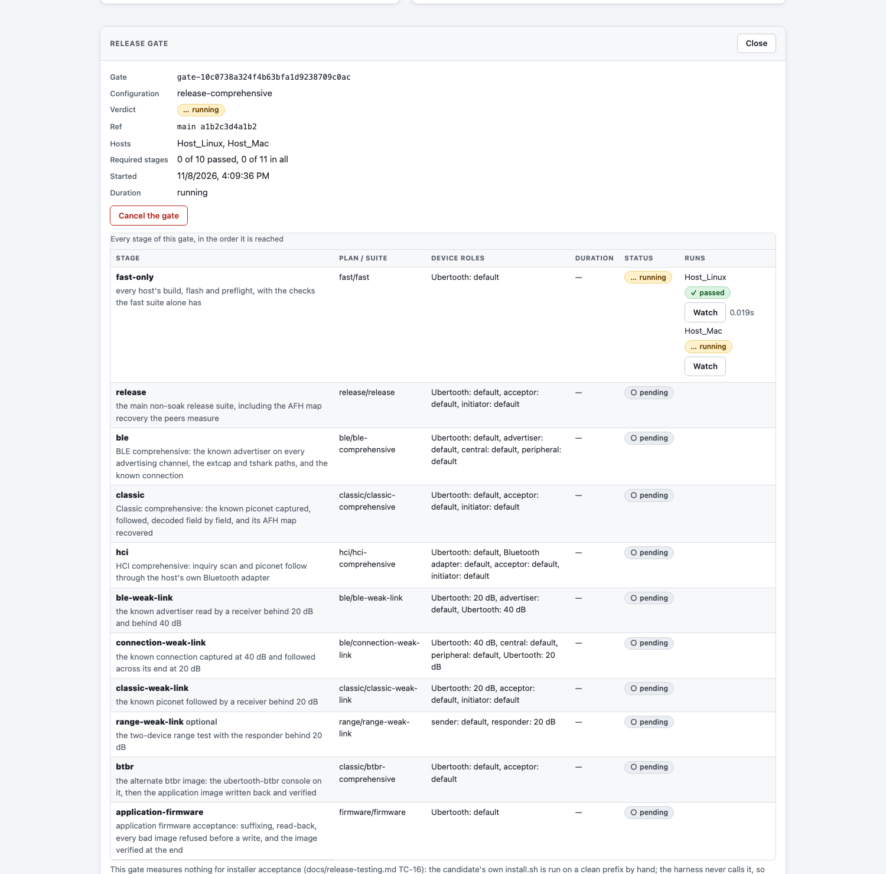
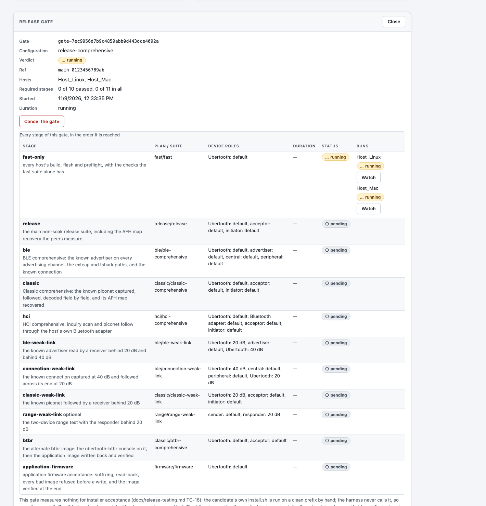
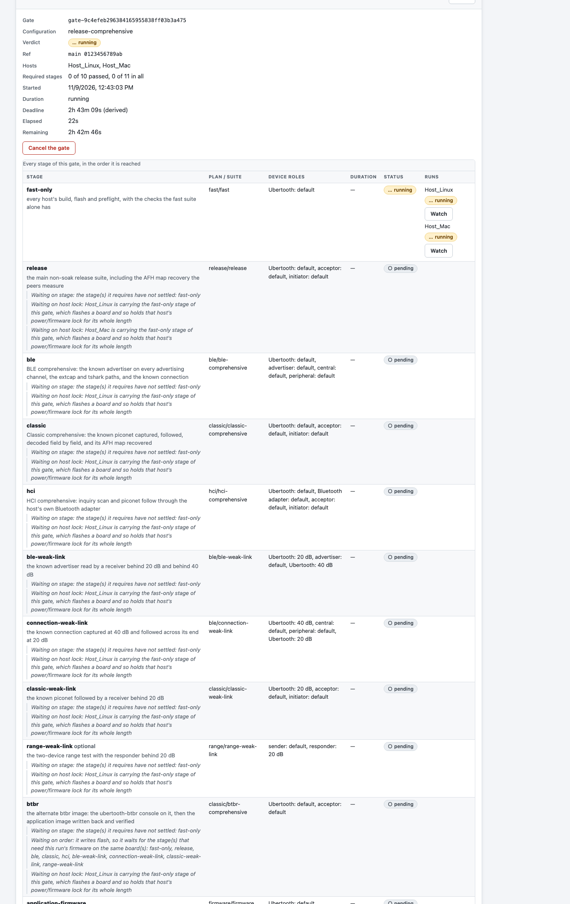

# The comprehensive release gate

Every bounded, recurring test a release has to pass, asked for once and
answered once. One name (`release-comprehensive`), one ref, one bench; one
verdict, one stage matrix, one email.

It is not one big suite. The tests a release needs cannot share a run: they
want different build options, different firmware on the board, different
fixtures, and three of them write flash. So a gate is a graph of **stages**,
and each stage is an ordinary [run group](../../README.md#run-a-suite) — its
own child run per host, its own leases, its own build flags, its own firmware
expectation, its own `report.md`, its own cleanup. Nothing about a child run
is special, and the gate reaches no target itself.

The test plan this gate carries out is [release-testing.md](../release-testing.md);
the configuration lives in `ubertooth_harness/releasegate.py`.

## The stages

| Stage | Plan / suite | What it is for |
|---|---|---|
| `fast-only` | `fast` / `fast` | every host's build, flash and preflight, with the checks the fast suite alone has |
| `release` | `release` / `release` | the main non-soak release suite, including the AFH map recovery the peers measure |
| `ble` | `ble` / `ble-comprehensive` | the known advertiser on every advertising channel, the extcap and tshark paths, the known connection |
| `classic` | `classic` / `classic-comprehensive` | the known piconet captured, followed, decoded field by field, its AFH map recovered |
| `hci` | `hci` / `hci-comprehensive` | inquiry scan and piconet follow through the host's own Bluetooth adapter |
| `ble-weak-link` | `ble` / `ble-weak-link` | the known advertiser read behind 20 dB and behind 40 dB |
| `connection-weak-link` | `ble` / `connection-weak-link` | the known connection captured at 40 dB and followed across its end at 20 dB |
| `classic-weak-link` | `classic` / `classic-weak-link` | the known piconet followed behind 20 dB |
| `range-weak-link` | `range` / `range-weak-link` | the two-device range test with the responder behind 20 dB. **Optional** |
| `btbr` | `classic` / `btbr-comprehensive` | the alternate image, then the application image written back and verified |
| `application-firmware` | `firmware` / `firmware` | suffixing, read-back, every bad image refused before a write, the image verified at the end |
| `bootloader` | `fast` / `fast`, one test | the bootloader built from this ref installed over the paired programmer if the board is behind, read back with the application image running again. **Opt-in** |

A stage's build options are not written down in the configuration: they are
read from what the suite's own tests declare they need, so a suite that starts
needing the Python tools does not also need an edit to the configuration.
Every stage builds and flashes, because a release is qualified on tools and
firmware built from the commit under test, and each stage's own preflight then
verifies what is on the board.

**Optional** means a bench may lack what the stage needs without blocking the
gate, and that the stage does not decide the verdict. `range-weak-link` is
optional because it transmits between two boards, wants an RF-isolated bench,
and its suite has not yet judged a result
([tests.md](../tests.md#two-device-range-test)).

**Opt-in** means the stage is left out unless it is asked for by name. The
bootloader stage writes the one part of flash an ordinary run cannot put back,
so it runs only when asked for, and then only on a board whose own registry
pairs it with a debug programmer; a host without one records what is installed
and writes nothing. A paired board that already carries the bootloader built
from this ref is compared and left alone, so the stage can pass having written
nothing — which is the right outcome, and not the same as having exercised the
write.

The `--bootloader check` arm of TC-17, which compares *every* board against one
built from the candidate, is not in the gate: a bench whose boards carry an
older bootloader would then fail every gate rather than being told to update
one board. The other stages record what each board has.

### What the gate does not cover

Named in every gate's summary and in its email, so a gate it has no stage for
is not mistaken for a gate nobody owes:

- **installer acceptance** ([TC-16](../release-testing.md#5-test-cases)): the
  candidate's own `install.sh` on a clean prefix, by hand. The harness never
  calls it, so no suite covers it. Record it with
  `release-evidence --attest`.
- **flash reliability** (`slow`, `mac`): it alternates against a pinned
  known-good image, which only `run-suite --artifact` can pass.
- **exclusive board topology**: it switches real USB power, which is armed on
  the runner (`--allow-power-changes`), never by a request.
- **`power`**: it leaves a board outside its application until its own
  recovery step, so somebody has to be at the bench.
- **the long variants** (`classic-long`, `btbr-long`) and **every soak**: no
  soak is a release gate ([section 11](../release-testing.md#11-optional-endurance-work)).

### Nothing is run twice

The fast suite and the main release suite overlap almost entirely: the same
test at `coverage: smoke` in one and `coverage: comprehensive` in the other.
The gate drops from the fast stage every test another stage runs at the same
coverage or better, which leaves it carrying the checks that are only in it —
and still carrying the build, the flash and the preflight of every host, which
is what makes it the cheap place for a failure. The matrix names each dropped
test and the stage that covers it.

The hosts count too: a test covered on the Linux host alone is not covered for
the Mac, so a stage that runs it on both keeps it.

## What may overlap, and in what order

A target runner runs one run at a time, and every fixture in a registry
belongs to a host. So two stages may overlap only when their host sets are
disjoint, and the gate lays the stages out in waves that way. On a bench with
one Linux host that is a sequence, which is the honest answer rather than two
runs fighting over one board; a Mac rides along in the stages whose plans say
`hosts: each`.

Order on one host is not left to chance:

- the fast stage goes first;
- the stages that write flash go last, in the order
  [section 6](../release-testing.md#6-execution-order-and-schedule) sets:
  `btbr`, then the application firmware, then the bootloader. Each writer
  *requires* the one before it, so a board whose firmware state is in doubt is
  never written again;
- the `btbr` stage writes the application image back itself, and the stage
  after it on that board flashes and preflights the application image, so the
  restoration is verified rather than taken on trust;
- every other stage requires only the fast stage, so one capture failing does
  not abandon the next capture.

A stage waits while any stage sharing a host with it is running, and while one
of its hosts is busy with a run of its own. The schedule is decided again
whenever a child run ends, from what has really settled.

### An end to every wait

A stage waiting for a host somebody else keeps busy used to be a wait with no
end: the gate stayed `running`, with no verdict and no email, and the matrix
said only that the stage was `pending` (#410). Two things answer that now.

**Every gate has a deadline.** It is derived from the stages' own estimates --
twice the estimate plus half an hour, held between one hour and twelve -- so a
gate of two stages and a gate of twelve are not given the same budget. The
estimate is a floor (it counts each stage's tests and each host's learned
build, not that host's flash or preflight), which is what the doubling and
the flat margin are for. The committed configuration's deadline is about
2 h 43 m.

A gate still going at its deadline is **given up on**: the expiry is recorded
first, so nothing more is started; the verdict becomes `failed`, because the
gate did not finish and nobody asked for it to stop; the stages behind it are
recorded as `not_reached` with the deadline as the reason; and each running
stage is cancelled the ordinary way, which stops its runs, releases their
leases and writes their reports. The completion email says the deadline is
why.

The gate is over at its deadline whether or not those cancels land. A child
whose runner is away may take as long as that runner does to come back, and a
gate that waited for one would be the wait this is here to end; its stage's
own row still says it was running and why it was stopped. The cancel is asked
for again on each later look, so an expiry interrupted by a controller
restart still reaches its children. To stop a child that is still winding
down, cancel that run from its own live card. An operator's cancel that is
already running decides the gate instead of the deadline, and says who asked.

`--deadline MINUTES` (`deadline_s` in the API and the GUI) asks for another
budget. It is validated against the same bounds, and a deadline shorter than
what the stages are estimated to take is a blocking preflight failure rather
than a gate that would fail for time it was never given.

**Every pending stage says what it is waiting for.** `waiting_on` on a
pending row carries one entry per thing in its way, each with a `kind`:

| Kind | What it means |
|---|---|
| `stage` | a stage it requires has not settled, named |
| `order` | it writes flash, so it waits for the stages that need this run's firmware on the same boards |
| `runner` | a host it wants has no runner registered, or that runner is not connected |
| `host` | a host it wants is carrying a run of its own; a runner runs one run at a time |
| `host lock` | the same, for a run that flashes a board: such a run holds that host's own power/firmware lock for its whole length |
| `lease` | a registered board on that host is leased by somebody else, with the holder as the lease file describes it |
| `fixture` | a registered board on that host has left USB, so a run that needs it would be refused |

A stage none of those explains, and that the gate is nonetheless holding,
names the stage of this gate still running on a host it wants — which is what
a stage running on two hosts looks like once it has finished on one of them.
Which board a stage will bind is the target's own answer, so the lease and
fixture reasons report that host's registered boards rather than only the ones
this stage would take.

What the controller knows about a bench is what each target reported: its
runner's connection, the run it is carrying, and each registered board's lease
and presence. The host's own lock file is the target's and is not reported, so
a run this controller started is named with what it holds and a run it did not
start is named as a run, with nothing claimed about the lock.

## Preflight, before any of it runs

A gate with one blocking failure starts nothing: a graph that would stop
halfway through has occupied the bench, written firmware and produced a
verdict nobody can use. What is judged:

| Check | Blocking | What it is about |
|---|---|---|
| immutable revision | yes | the ref resolved to one commit, and every stage of every host is sent that commit, so a branch that moves mid-gate cannot split it |
| every required stage has a host | yes | a required stage no host of this gate runs blocks the gate; an optional one is skipped and named |
| no stage needs a passed-in image | yes | an image no build makes can only come from `run-suite --artifact`, which a dispatched run has no way to pass |
| a board on every stage's host | yes | each target reports its own boards; a host whose registry holds none that USB can see runs no stage of this gate |
| disk budget | yes | room where the records are kept |
| bootloader acceptance | no | whether the opt-in stage was asked for |
| estimated wall time | no | the whole gate's estimate against the two-hour target the procedure sets |
| whole-gate deadline | yes, when the two figures contradict | the budget the gate is given, and that the stages could finish inside it: a deadline shorter than the estimate would fail the gate for time it was never given |

The committed configuration is about 1 h 07 m of test time, plus each stage's
own build, flash and preflight. That leaves the separate four-hour soak and
keeps a release inside six hours
([section 6](../release-testing.md#6-execution-order-and-schedule));
exceeding it is a procedure failure to correct, which is why it is a warning
and not a refusal.

What preflight cannot judge is the rest of a bench. The controller holds each
target's **boards**, and checks them; the ESP32 peers, the DKs, the host's
Bluetooth adapter, the attenuated board and the debug programmer are in the
target's own resource registry, which the controller does not hold. A stage
whose fixture is absent is therefore the target's own refusal, in the middle
of the gate rather than before it: a required stage that fails for it fails
the gate rather than passing it unmeasured, but the bench has been built and
flashed by then. Before a long gate on a bench that has been rearranged, a
`run-suite --dry-run` of the peer suites is still worth the minute
([release-testing.md](../release-testing.md#3-entry-criteria), entry criterion 7).

Two figures in the answers are both lengths of time and are not the same
quantity, so they are named apart: `estimated_s` in a preflight is the whole
gate's wall estimate (each wave costs its slowest stage, with that stage's
build added), and `test_seconds_total` on a gate is every stage's test time
added up.

## The verdict

One verdict out of the stages: `running` while any stage is still to come or
still going, and otherwise the worst of what the **required** stages came to.
It is `passed` only when every required stage passed.

An optional stage does not decide the verdict — a bench without the fixture it
needs would otherwise never produce a pass — and what became of it is reported
beside the verdict (`optional_problems`) rather than swallowed.

`unverified_restores` names a stage that writes the application image back
itself where no later stage on that board flashed and preflighted it — the
`btbr` stage when the writers behind it were abandoned. The case's own cleanup
still writes the image back; what is missing is the independent check, and the
summary says so rather than implying one happened.

A stage the gate decided not to run carries its own reason:

| Stage status | What it means |
|---|---|
| `skipped` | optional, and this bench has nothing to run it with, or an opt-in stage nobody asked for |
| `not_reached` | a stage it requires did not pass, or the gate's deadline passed before this stage started; the reason names which |
| `canceled` | the gate was cancelled before this stage started |
| `failed`, `error` | its start was refused, or its own runs came to that |

A gate that reached its deadline is at worst `failed` whatever its stages came
to, with `deadline_expired` set and the deadline named in the reason, so
cancelling its last running stage cannot leave it reading as a gate somebody
cancelled. A stage that came to an `error` still shows through, because an
error outranks a failure.

## Run it from the command line

Without `--controller`, nothing is started: the configuration is compiled for
the hosts named and its stages, waves and preflight are printed, which is the
dry run of a whole gate.

```sh
python -m ubertooth_harness release-gate --hardware hardware.yaml
python -m ubertooth_harness release-gate --hardware hardware.yaml --with-bootloader --json
```

With one, the gate is started on that loopback controller — which resolves the
ref once, preflights the graph and refuses it as a whole — and followed to its
verdict. Ctrl-C cancels the gate: its running stages are stopped and nothing
more is started.

```sh
python -m ubertooth_harness release-gate \
  --controller http://127.0.0.1:8765 \
  --hardware hardware.yaml --ref 2026-11-RC1 --follow
```

`--follow` exits non-zero unless the gate passed, and prints, at the end, the
`release-evidence` command naming every stage's run directory on the test host
([release-evidence.md](../reference/release-evidence.md)).

Useful options:

| Option | What it does |
|---|---|
| `--config NAME` | the named configuration (one today, `release-comprehensive`) |
| `--host NAME` | a host to run it on; repeatable. With `--hardware` and no `--host`, every registered host |
| `--hardware REGISTRY` | take the hosts and their platforms from a registry |
| `--with-bootloader` | include the programmer-paired bootloader acceptance stage |
| `--commit COMMIT` | the commit `--ref` was listed at, so a ref that has moved is refused rather than run |
| `--deadline MINUTES` | the whole-gate deadline, 60 to 720 minutes; without it, the one the stages' estimates derive |
| `--poll SECONDS` | how often `--follow` asks the controller |
| `--json` | the whole answer as JSON |

While a gate runs, the printed matrix carries the deadline with how long the
gate has been going and how long it has left, and one `waiting on (<kind>)`
line per thing a pending stage is waiting for.

## Run it from the GUI

In Run setup, **What to run** chooses between one plan and suite and a release
gate. The gate's configuration decides the plans, suites, test selections and
build options, so those fields are held; what is left to choose is the ref,
the hosts, whether to include the bootloader stage, and -- if the derived
deadline is not what you want -- a deadline of your own in minutes, which the
summary and the preflight above Run judge before anything starts.

Before: Run setup as it was, one plan and one suite.



After, with the gate chosen: every stage with the wave it runs in, what it is
for, what it leaves to another stage, and the preflight of the whole graph.
Run is held while anything blocking fails.



Once it is started, the **Release gate** panel carries the verdict and the
stage matrix: each stage's plan and suite, the device roles it binds, its
duration, its verdict, and its runs with a Watch button that opens that
child run's own live card. Cancel the gate stops the running stages and lets
nothing else start. The gate is in the page's address
(`/ui/#gate=<id>`), so reloading, or passing the address on, comes back to it.



The panel also carries the deadline, with how long the gate has been going and
how long it has left, and every pending stage says what it is waiting for.
Before, a stage that was about to start and one that never would read the
same:



After: the deadline with its elapsed and remaining time, and each pending
stage's own reasons.



## Email

One notice for the whole gate when its last stage settles: the verdict, the
commit, how long it took, one line per stage with that stage's verdict,
duration and run IDs, the deadline when that is why the gate ended, and the
gates this configuration measures nothing for. The child groups send none of
their own, so a gate of twelve stages is one message rather than twelve. It is
off unless completion notices are configured
([notifications.md](notifications.md)).

## The API

| Request | What it does |
|---|---|
| `GET /api/release-configurations?config=NAME&host=HOST&with_bootloader=true&deadline_s=SECONDS` | what a gate would do on those hosts: every stage, the waves, the deadline, and the preflight. Starts nothing |
| `POST /api/release-gates` | `{config, hosts, ref, commit, with_bootloader, deadline_s}`; 201 with the gate, or 422 with what preflight refused |
| `GET /api/release-gates` | the newest gates, 50 at most (`?limit=N`), with how many there are in all. A gate carries every stage with every run, so the whole store is not an answer to give |
| `GET /api/release-gates/{gate_id}` | one gate: its verdict, its deadline with the elapsed and remaining time, and its stage matrix with each pending stage's `waiting_on` |
| `POST /api/release-gates/{gate_id}/cancel` | `{reason}`; every running stage is cancelled and nothing still to come is started |

The controller listens on `127.0.0.1` only, as it does for everything else
([services.md](services.md)).

## The record

One file per gate under `release-gates/` beside the run directories, holding
what was asked for and which child group each stage became. Everything else —
a stage's verdict, the gate's verdict, when it finished, how long it took — is
derived from the children's own records, so nothing here can disagree with a
run. The stages are stored as they were asked for, so a gate reports what it
started even after the configuration or a plan file changes under it, and a
controller that restarts picks its gates up from these files.

The deadline is stored with them (`deadline_s`, `deadline_source`,
`deadline_expired`), and counted from the record's own `created_at`, so a
controller that restarts gives a gate the deadline it was started with and
measures it over the gate's whole life rather than from the restart. A record
written before gates had a deadline is read with the budget a configuration of
unknown length gets; one whose deadline is there and cannot be read is refused
as unreadable, because a gate with no deadline is the wait this is here to
end.
