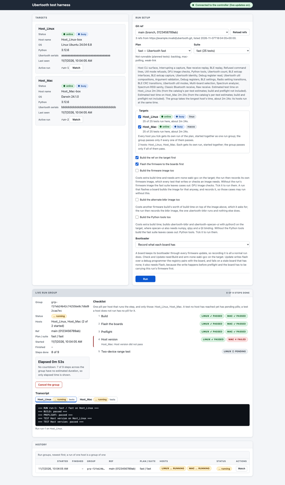

# Controller, runner, and web GUI

The services and the GUI. Deploying them is in [deploy.md](deploy.md).

## Target runner service

`python -m ubertooth_harness runner` is the persistent target runner. It dials
the controller (outbound only; it opens no listening socket), registers, sends
heartbeats, and runs the suites the controller requests through the same
`run-suite` path, one run at a time:

```sh
python -m ubertooth_harness runner \
  --controller ws://127.0.0.1:8765/ws/runner \
  --hardware hardware.yaml --host Host_Mac \
  --ubertooth-source /path/to/ubertooth \
  [--libbtbb-source /path/to/libbtbb \
   --libbtbb-ref d356e9da7fb03969371aa14d603a8aad2f0ef198] \
  [--plans-dir testplans] [--allow-power-changes] \
  --output runs
```

The controller URL must be `ws://` or `wss://` with a loopback host
(`127.0.0.1`, `::1`, or `localhost` when every address it resolves to is
loopback). Any other host is refused at startup and there is no override:
remote runner authentication is still an open design item (see
[Networking status](../../README.md#networking-status)). URLs with credentials are refused.
The runner connects to the checked loopback address itself, ignores proxy
settings, and follows no HTTP redirects.

On every connection the runner sends `register` with its registry host, host
name, OS identity, Python version, and attached Ubertooth serials, read the
same read-only way power isolation reads them on Linux: from sysfs there, and
on macOS from the IO registry with `ioreg -p IOUSB -l -w0 -a` (the kernel's
own record of what it read when each device was enumerated). Neither opens a
device, so registration cannot send a stop to a board that is capturing. A
board in its DFU bootloader reports no serial on either platform and is
listed as `unidentified:<where it is on the bus>:<product id>`. The serials
are `null`, with an `enumeration_error`, only where neither is available or
the read failed.
A `run` request names a git ref and the commit the controller listed for it
(the runner runs exactly that commit; only when the controller could not list
refs is the commit `null` and the ref resolved in `--ubertooth-source`), a
plan in `--plans-dir` (`fast` is `testplans/fast.yaml`), a suite, optional
exact test names, whether to `--build`, and, with `build`, whether to flash
the boards with that build first (`flash_build`; false passes
`--no-flash-build`, see [Flashing the boards with the run's
build](builds-and-firmware.md#flashing-the-boards-with-the-runs-build)) and whether that build also
builds and records the firmware image (`with_firmware`, which passes
`--with-firmware`), the alternate btbr image (`with_btbr`, which passes
`--with-btbr`), or the Python tools (`with_python`, which passes
`--with-python`). `run-suite` takes none of those three without `--build`,
so a request that asks for one without `build` is refused rather than sent.
All three are booleans: `with_python` always builds against `python3` on the
target's PATH, since the request has no way to name another interpreter the
way `--with-python=PYTHON` does on the command line.
A run that needs an image a build cannot produce (the published KGV image of
`Flash reliability`) still has to come from the command line, which is where
`--artifact` can be passed. When the commit (or ref) is not
in `--ubertooth-source` yet, typically because it was pushed after the
checkout was last fetched, the run fetches it once from the checkout's remote
(`origin`, or the remote a `remote/name` ref names) within 60 s and resolves
it again; a full commit is fetched directly, a name fetches every branch and
tag. The fetch only adds objects, remote-tracking branches and tags: the
working tree, `HEAD` and local branches stay as they are, and a dirty
checkout is still refused first. If the fetch fails, or the remote does not
have the commit either, the run ends with `run_error` naming the ref, the
remote and why. The `--libbtbb-ref` commit is fetched into
`--libbtbb-source` the same way. `--libbtbb-ref` is passed to every run as
given, so `fork-pin` (what `scripts/deploy.sh` sets by default, see [Building
the resolved revision](builds-and-firmware.md#building-the-resolved-revision)) makes each run build
the libbtbb its own Ubertooth commit pins. A runner started without
`--libbtbb-source`/`--libbtbb-ref` cannot build: it says so in its log at
startup (`builds disabled: ...`; with them, `builds enabled: libbtbb REF from
DIR`, or `fork-pin (the LIBBTBB_REF of each commit it builds)`), and answers a
`run` with `build` set with `run_rejected` and that
reason, which the GUI shows as "Not started: runner rejected the run: ...",
instead of starting a run that fails at once. The runner starts `run-suite` in this harness
environment with a new run ID, answers `run_accepted`, and forwards every
run.jsonl record unchanged as an `event` message as it is written, then
`run_finished` (the run's own status and exit code) or `run_error` (the run
ended without a `run_finished` record, for example an unresolvable ref). The
run directory (run.jsonl, report.md) stays the source of truth. A second
`run` while one is active gets `run_rejected`. `cancel` sends the run SIGINT,
which run-suite turns into its normal cooperative cancellation, including
restoration of isolated boards. `--allow-power-changes` is a runner flag only;
the controller cannot arm power switching.

If the controller goes away the run continues. The runner reconnects with
exponential backoff (0.5 s doubling to at most 30 s), registers again with
`active_run_id` set, and replays the active run's events from the start of
run.jsonl, so the controller deduplicates by `(run_id, sequence)`. SIGINT,
SIGTERM, or SIGHUP stops the runner after cancelling and waiting for an
active run.

Messages are JSON objects with `"version": 7` and a `type` (version 2 added
the run's `commit`, version 3 its `flash_build`, version 4 the `run_file`
request and its answers, version 5 the run's `with_firmware` and
`with_python`, version 6 its `bootloader`, version 7 its `with_btbr`; a
runner or controller of
another version is refused); each type has an
exact field set, and anything else (unknown version or type, a missing or
extra field, a wrong value, or a combination the receiver could not act on,
such as `with_firmware` without `build`) gets `protocol_error` and is not
acted on. The
schema is in [`ubertooth_harness/protocol.py`](../../ubertooth_harness/protocol.py)
and [DESIGN.md section 2](../reference/runner-protocol.md).

## Controller

`python -m ubertooth_harness controller` is the controller: it keeps the target
registry, dispatches runs to target runners, stores their results, and streams
live updates for the GUI. It listens on `127.0.0.1` only. There is no `--host`
option or environment override (`--host`, `UVICORN_HOST` and similar are
refused), and there is no authentication: remote authentication is still an
open design item (see [Networking status](../../README.md#networking-status)), so access
from another machine is an SSH tunnel.

Trust boundary: loopback-only is not access control. Every local user and
process on the controller host can call the whole API (start and cancel runs,
read results) and can register as a runner for any target name. With the
`ssh -R` forward below, the same holds for every local user and process on that
target. There is no authentication yet ([DESIGN.md section
8](../../DESIGN.md#open-items)); run the controller and runners only
on hosts whose local users you trust. A registration for a host that is
already connected replaces the old connection (so a runner whose previous
connection is half-open can reconnect); the controller logs a warning when the
replaced connection was still online. The old connection is closed (1008
`replaced`), and a start or cancel request still waiting on it fails with 503
`runner reconnected`; ask again and the request goes to the new connection.
Anything the old connection still sends is dropped with a warning, never
applied to the target.

```sh
python -m ubertooth_harness controller --port 8765 \
  [--results-dir ~/.local/share/ubertooth-harness/controller/runs] \
  [--ubertooth-repo https://github.com/SqueakyFloors/ubertooth.git] \
  [--plans-dir testplans]
```

`--ubertooth-repo` is the repository whose branches and tags the GUI offers
(listed with `git ls-remote`, cached for 60 s; no token is needed for a public
repository). It defaults to the public fork, the same repository CI builds. A
run may only name a ref from that list (or `HEAD`) or a full commit ID;
anything else is refused with 422 before the runner is asked. If the list
cannot be fetched (for example an offline lab), the ref is passed to the
runner unchecked and the controller logs a warning. The run request carries
the commit the list gives for the ref, and the runner runs that commit, not
its own checkout's idea of the ref, so a stale or differently configured
`--ubertooth-source` cannot substitute another commit; a commit missing there
is fetched from its remote (see [Target runner service](services.md#target-runner-service)),
and the run ends with `run_error` only when that fails. The GUI
sends the commit it showed: if the ref has moved since the page listed it,
the start is refused (409) and the page lists the refs again by itself, so
the next Run sends the current commit. A name that is both a branch and a
tag at different commits is two entries in the GUI, labelled branch and tag,
and each sends its own commit; an API caller that names it without a
`commit` is refused (422) and told to send the commit of the entry it means.
The commit is recorded as `commit` in the run's `run.json` and shown next to
the ref in the GUI; the runner passes the ref name as
`--ubertooth-ref-name`, so the run's manifest records both (`ref_name` and
`commit`) and report.md shows `` `main` at `<commit>` ``. `--plans-dir`
is the directory of plans the GUI lists (default `testplans/`).

Start a runner on the same machine against it:

```sh
python -m ubertooth_harness runner \
  --controller ws://127.0.0.1:8765/ws/runner \
  --hardware hardware.yaml --host Host_Linux \
  --ubertooth-source /path/to/ubertooth --output runs
```

Tunnels (the controller checks the `Host` header, so keep the same port number
on both ends):

```sh
# Browser or curl on a laptop -> controller on the lab server.
ssh -N -L 8765:127.0.0.1:8765 lab-server
curl http://127.0.0.1:8765/api/targets
# Then open http://127.0.0.1:8765/ui/ in the laptop's browser.

# Runner on another target -> controller on the lab server. Run this on the
# lab server; the forwarded port binds only the target's loopback (sshd's
# default GatewayPorts no), and the runner there dials
# ws://127.0.0.1:8765/ws/runner.
ssh -N -R 8765:127.0.0.1:8765 target-host
```

### Web GUI

Open `http://127.0.0.1:8765/ui/` (through the tunnel above when the
controller is on another machine; a browser that asks `GET /` for HTML is
sent there). It is three static files in `ubertooth_harness/web/` (vanilla
JavaScript, no build step, nothing loaded from another site) and uses only the
REST and `/ws/live` endpoints below. Each section is a card: Targets and
Run setup side by side on a wide window, Live run and History full width
below, one column on a narrow one. It follows the system light or dark
setting, uses the system font, and shows every status as a pill with its
word and symbol (colour only reinforces it).



- **Targets:** one card per registered target: host, host name, OS, Python,
  Ubertooth serials (or why they are unknown), online/offline (plus busy
  while it runs), last seen, and
  the active run with a Watch button.
- **Run setup:** git ref (default branch, branches and tags from
  `/api/refs`), plan and suite (from `/api/plans`, with the suite's tests,
  each with an info button that says what it is for;
  only runnable plans are offered, and plans of planned tests such as
  `backlog` are named as not runnable), target, whether to build the ref first,
  "Flash the firmware to the boards first" (ticked by default; disabled,
  with a note, while Build is unticked; see [Flashing the boards with the
  run's build](builds-and-firmware.md#flashing-the-boards-with-the-runs-build)), and the three
  further build options, "Build the firmware image too" (`--with-firmware`),
  "Build the alternate btbr image too" (`--with-btbr`) and "Build the Python
  tools too" (`--with-python`); Run starts the whole suite.
  Each of those three carries a note saying what it costs and follows what the
  chosen suite needs. A suite with a test that cannot run without the option
  (`DFU images`, and `Flash reliability` where its plan entry's `image
  sequence:` names the run's own image; `Classic btbr console` for all three)
  has it ticked and held there. A suite that would only leave cases out without it
  (`DFU image checks` without the image, `Python tools` without the Python
  build) is named in the note, which invites the tick but does not tick it:
  a build nobody asked for costs time, and the firmware build needs
  arm-none-eabi-gcc, which a target may not have. Otherwise the box is yours
  to set, and keeps what you set. All three need Build, and are disabled with a
  note while Build is unticked. `/api/plans` is where those needs come from:
  every test and suite carries `needs_firmware_build`, `needs_btbr_build` and
  `needs_python_tools` (cases left out without it) and
  `requires_firmware_build`, `requires_btbr_build` and
  `requires_python_tools` (the test cannot run
  without it), from what the catalog declares and, for a test whose plan
  entry names its images, from that entry. The alternate btbr image is one of
  them in its own right: a firmware build makes the application image, so a
  run carrying that one alone would otherwise look able to run the btbr test
  ([#279](https://github.com/SqueakyFloors/ubertooth-test-harness/issues/279)). A suite that also needs an image
  no build makes (`Flash reliability`'s published KGV image) says so under
  the suite list, with the `--artifact` line to run it with, because a run
  started from the GUI cannot carry one and would be refused before its
  tests.
  Everything under the selectors is what the **chosen target** would do with
  the suite: the plan list is fetched for that target, so the estimate adds
  up only the steps it runs, and so do the build options the suite asks for.
  A step whose plan entry names other hosts (`Recover AFH map` in the
  release suite, which names the host its ESP32 Classic peers are on), or
  one the target's own platform does not run (`Exclusive Ubertooth topology`
  on a macOS target), is left out of the figure and then named, with the
  time it takes on the host that does run it: the release suite is about
  669.7 s on a target that step does not name, and 1189.7 s counting it.
  Choosing another target reloads the list and keeps the plan and suite you
  had chosen. A suite no step of which runs on the chosen target says that
  instead of a time. Estimates learned on the target are used wherever it
  has them (see [Learned durations](#learned-durations)), and the line says
  how many of them are its own measurements. Hardware the bench has not got
  is not part of this: the controller has no copy of the target's registry,
  so the run itself is what reports a step whose device is missing.
  **Run is held** for a suite this target could not measure, with the reason
  above the button: a suite no step of which runs there, and one holding a
  step whose own hardware is what it measures
  ([`required hardware:`](plans-and-resources.md#hardware-a-step-is-about-blocked-not-left-out))
  whose `hosts:` names no host of the run — a release gate that run could
  never measure, whatever the bench has. The reason names the step, the
  hosts it is required on and the hardware it needs there, for example
  "Recover AFH map is required on Host_Linux, which needs Ubertooth, ESP32
  Classic peer (acceptor), ESP32 Classic peer (initiator) there". Starting
  it anyway through the API is refused the same way (422), and a run group
  is judged by its hosts together, so the release plan across the bench
  starts and measures the gate once. Everything else about the bench is the
  run's to report: hardware a host of the run has not got blocks that step
  and fails the run, and the unrelated tests still run.
- **Live run:** the suite's tests as a checklist that ticks from the run's
  events (✓ passed, ✗ failed, … running, ○ pending or not run; always text
  plus symbol), under each test the [known target](../reference/run-records.md#known-targets) it ran
  against or a line saying it had none, the current stage (building,
  preflight, tests), elapsed time,
  a Cancel button, a "Queued behind another command" line for each device the
  run waited behind before it started (see
  [Why a board can be free and still nobody's](leases.md#why-a-board-can-be-free-and-still-nobodys),
  shown only when it waited behind somebody), and the last 200 log lines in a
  scrolling console panel. A countdown is shown only when
  every test in the suite has an estimate. Every implemented test has a
  catalog estimate (`ESTIMATES` in `ubertooth_harness/catalog.py`) for each
  coverage profile: fixed seconds, plus a multiple of its `duration` argument
  for tests that capture (for example comprehensive `Raw receive` is 9 s plus
  20 times the duration), plus seconds per flash for `Flash reliability`.
  They are calibrated from run records on a macOS host with two Ubertooths:
  the release plan run for comprehensive, the recorded smoke runs for smoke
  (or the comprehensive time per step scaled to the smoke steps where no
  smoke run exists); `Exclusive Ubertooth topology` and `Two-device range
  test` (Linux only) are calibrated from runs on the Linux lab host. A test with no implementation yet is
  estimated at its `duration` argument, if any. A Linux host, one board, or a
  failing test ends sooner or later, so the countdown is a guide, never a
  timeout. Under the clock, a Boards list appears once the run has read a
  board's firmware watchdog record: each board with the times it has reset
  itself during this run and the last warning if there was one (see
  [Firmware watchdog](transitions-guards-watchdog.md#firmware-watchdog)). An estimate is per invocation: `Ubertooth: each` runs the test
  once per board the target selects. Run setup counts such a test once and
  says so; once the run's manifest arrives (before preflight) the live
  checklist lists every planned invocation on the target with its estimate,
  so the countdown counts every board, and each invocation's estimate is the
  one [learned on that target](#learned-durations) once its own runs have
  measured it. Build and preflight time are not included: the countdown
  starts with the first test. Otherwise the view shows elapsed time and says
  why. Under each test is a line of links, one per file that test saved (the
  build's and preflight's are listed under the checklist), with the stream,
  the size and the number of checks that read it in the link's tooltip and
  the failure color on a file a check came out against; opening one shows a
  bounded page of it in a panel beside the log tail, black on white in a
  fixed-width font so a saved file is never mistaken for the live stream,
  with the recorded size, line count and SHA-256 above it and which bytes
  are shown below. A run a target runner carried out keeps those files in
  that runner's own run directory, so the controller asks the runner for the
  page; while the runner is not connected the file is listed as `name (on
  the target)` and is not a link. The view is linkable as
  `/ui/#run=<run_id>`, and `/ui/#run=<run_id>&file=<path>` opens that file.
- **History:** every run, newest first, with started/finished times, ref,
  plan/suite, target and status, a link to its `report.md`, and for a run
  that did not pass a failure summary (each failed phase or test with its
  reason and last output lines, then the run's own reason).
- **What a test is for:** beside every test name — in Run setup's suite
  list, the live checklist, and a failure summary — is a small round *i*
  button that opens a dialog in the page: the test's purpose, theory of
  operation, hardware and traffic, expected outcome, what a pass does not
  prove, what the catalog binds and accepts, its catalog estimate and
  profile as the listing it was opened from gives them (a test two plans
  list at different coverages has an estimate per listing, and the line
  names the one it read), the plans that list it (so a longer or soak form
  of it is visible), the issues behind it, and a link to its
  [docs/tests.md](../tests.md) section in a separate tab. It is a real
  button: Tab reaches it, Enter or Space opens it, focus enters the dialog
  at its heading, and Escape or Close returns focus to the button. The
  prose is [`ubertooth_harness/test_info.yaml`](../../ubertooth_harness/test_info.yaml),
  which `/api/plans` sends once per response keyed by the catalog name; the
  roles, arguments, profile and estimate come from the catalog on the test
  row, so neither has two sources. A test with no entry, and a file the
  controller could not read, leave the dialog saying so with the catalog's
  own facts still under it; none of it can hold up a run.

Every HTTP response carries `Content-Security-Policy: default-src 'self';
script-src 'self'; style-src 'self'; connect-src 'self' ws://<host>;
frame-ancestors 'none'; ...` (no inline script or style),
`X-Content-Type-Options: nosniff`, `X-Frame-Options: DENY`,
`Referrer-Policy: no-referrer` and `Cache-Control: no-store`. The page inserts
controller and runner text only as text, never as HTML. Static files are
served from memory by exact name, so no request path reaches the filesystem.

### Run groups: one plan on several hosts

A run on several hosts is a **run group**: `POST /api/run-groups` takes the
same run request with a `hosts` list and starts **one child run per host**,
together. Each child is an ordinary run of its own host, with its own runner,
boards, leases and run directory, and records the group it belongs to as
`group_id` in its `run.json`; the runner protocol is unchanged, so a target
needs nothing new. The GUI side of this (choosing several hosts, a pill per
host on every row, a transcript tab per host) is the next step and is not
built yet, so for now a group is started through the API.

The ref is resolved once and every child is sent that commit, so a branch
that moves while the runs are starting cannot leave one host on another
revision. Each host then stands on its own: one that is offline, busy, or
whose runner rejects the run leaves its reason on that member while the
others run, and the group says it did not run everywhere (`complete: false`,
and `error` once nothing is running). A group not one host of which started
is no group at all: nothing is stored and the answer names, host by host,
why. The exception is a request that timed out: it stays pending and may
still be accepted, so that group is stored and a child that arrives late is
still one of its hosts, while the answer still says nothing started. Such a
host reads `starting` until its request is answered or expires, so a group
whose child may still arrive does not read as finished and then run again.
Once the last of those requests is gone, no child can arrive: the host says
the runner never answered, and a group with no child at all is forgotten,
record and all. Such a request cannot outlive the controller,
though: a controller restarted while one was pending has no record of it, so
a run the runner reports afterwards is adopted as a run of its own.

A group's status is read from its children, so it cannot drift from them:
`running` while any child is active (including one still being started,
whose member reads `starting`), `passed` only when every host asked for ran
and passed, otherwise the worst outcome among them — an error, then a
failure, then a [lost](services.md#controller) run, then a cancel, and a status this
code does not know ranks as an error.
`POST /api/run-groups/{group_id}/cancel` cancels every active child and
reports each host's outcome. A host that is still starting has nothing to
cancel yet; its outcome says so, and the child its runner may still accept
is cancelled as it arrives.

`GET /api/run-groups/{group_id}` is the per-host result: one row per step —
build, flash, preflight, then the tests in planned order — each with one cell
**per host that runs that step, and only those**, so a Linux-only test has a
Linux cell and no macOS one. Which steps a host runs comes from that run's
own manifest record, which is what its planner compiled there. Each cell
carries the status, when it started and finished, how long it took, why it
failed, the estimate [learned for that host](#learned-durations), and its
parts (a test's invocations, one per board; a flash's boards). A required test
the planner could not compile on a host ([blocked, not left
out](plans-and-resources.md#hardware-a-step-is-about-blocked-not-left-out)) has no invocation, so
its cell is that planning record and reads `blocked`, which ranks worse than
a pass: a host where one board ran and another was blocked does not read as
passed.

A run started on one target of its own (`POST /api/targets/{host}/runs`)
stores no group record and is listed as a **group of one** whose ID is the
run's own, so `GET /api/run-groups` is the whole history whatever started a
run. Group records live in `groups/` beside the run directories, one JSON
file each, holding only what was asked for, which run each host got, and
whether a cancel was asked for.

```sh
# Start the release suite on the Linux lab host and a Mac, as one group.
curl -s -X POST http://127.0.0.1:8765/api/run-groups \
  -H 'Content-Type: application/json' \
  -d '{"hosts": ["Host_Linux", "Host_Mac"], "ref": "main",
       "plan": "release", "suite": "release", "build": true}'
# Follow it: one stream carries both hosts' runs and events.
# ws://127.0.0.1:8765/ws/live?group_id=<group_id>
```

Endpoints (JSON unless noted; `GET /` lists them):

| Endpoint | |
|---|---|
| `GET /ui/` | the web GUI (HTML, `app.js`, `app.css`) |
| `GET /api/refs` | `{"repository", "refs": [{"name", "kind", "commit"}], "fetched_at"}` from `git ls-remote` (`kind` is `default`, `branch` or `tag`); 503 if it cannot be listed |
| `GET /api/plans[?target=HOST]` | every `<plan>.yaml` in `--plans-dir` with its suites, test names, per-test `estimated_s` (one invocation with the step's arguments, else null) and `per_board` (runs once per selected board), the build options each test and suite needs (`needs_firmware_build` and `needs_python_tools`: cases are left out without it; `requires_firmware_build` and `requires_python_tools`: the test cannot run without it at all) and `needs_artifacts` (image labels the step names that no build produces, so only `run-suite --artifact` can pass them), the suite total when every test has one, `per_board_tests`, and `runnable` (the plan's `runnable` flag; false for plans of planned tests and for a plan that does not load); a plan that does not load is listed with its `error`. With a `target`, `estimated_s` is what that host's own runs measured when enough of them did; `catalog_estimated_s`, `estimate_source` (`learned`, `catalog` or `none`), `estimate_samples` and `estimate_scaled` say which, and `stages` lists the build, preflight and flash durations learned for it (see [Learned durations](#learned-durations)). Without one, nothing is learned and the catalog estimate stands. A `target` also decides which steps the suite's own fields count: a step whose `hosts:` names other hosts is compiled for those hosts and not for this target, and, when that target has registered, a step its `platform` could not run (the response names the platform too) is left out as the planner leaves it out. Each test therefore carries `runs_on_target` (and `omitted_reason` when false), and the suite total, `unestimated_tests`, `per_board_tests`, the four build-option flags and `needs_artifacts` cover only the steps that target runs. The steps left out are listed in `omitted_tests` (`name`, `reason`, `estimated_s`) with their time together in `omitted_estimated_s` when every one of them has an estimate, so a smaller total is accounted for; a suite with no step for the target has a null total. An omitted step that names exactly one host is timed on that host, so its whole estimate group in `tests[]` (`estimated_s`, `estimate_source`, `estimate_samples`, `estimate_scaled`) is what that host learned rather than the target's; one that names several, or none, carries the catalog estimate. Hardware this bench has not got is not answered here: the controller has no copy of the target's resource registry, so those steps are counted and the run itself reports them. A suite a run on that target could not measure also carries `runnable_on_target: false` with `not_runnable_reason` (the one sentence `POST .../runs` refuses with) and `blocked_tests`: the required steps such a run would not run, each with `name`, the `hosts` it is required on, the `hardware` it binds there, and the `reason` it is not run here. Without a `target` nothing is left out, nothing is refused, and the fields are the whole suite's, whichever host runs a part of it. A `target` whose name is not a host name is refused with 422; a name no target has registered is answered with whatever has been learned under it, which is normally nothing, with no platform, and with every step its `hosts:` names it |
| `GET /api/targets`, `GET /api/targets/{host}` | registry: host, hostname, OS, `platform` (the registry platform its OS is, `linux` or `macos`, else null), Python, Ubertooth serials, last heartbeat, `online`/`offline`, connected, active run |
| `POST /api/targets/{host}/runs` | start a run with the protocol `run` fields: `{"ref", "commit": null, "plan", "suite", "tests": [], "build": false, "flash_build": true, "with_firmware": false, "with_btbr": false, "with_python": false}` (`commit`, optional, is the full commit the caller saw listed for `ref`; `flash_build` applies only with `build` and is recorded false without it; `with_firmware`, `with_btbr` and `with_python` add `--with-firmware`, `--with-btbr` and `--with-python` to the run's build, and any of them without `build` is refused with 422 naming it); 201 with the run (including the `commit` sent to the runner), 409 busy, offline, rejected by the runner, or `ref` moved away from `commit`, 422 invalid, a ref not in `/api/refs` (full commit IDs are accepted), or a name listing several commits, 504 no answer. A run the plan says this target could not measure is refused with 422 before the ref is resolved: a suite no step of which runs there, and a step whose own hardware is what it measures (`required hardware:`) whose `hosts:` names no host of the run (see [Hardware a step is about](plans-and-resources.md#hardware-a-step-is-about-blocked-not-left-out)); the detail names the step, where it is required and the hardware it needs there. The order is the request's own faults before the target's state: an unknown target (404), then a suite this run could not measure (422), then the ref and the build options (422), then a target that is offline or busy (409) — a refusal the suite earns does not go away when the target comes back, so it is the more useful answer. Hardware the bench has not got is the run's to report, not this check's. |
| `POST /api/run-groups` | start a [run group](#run-groups-one-plan-on-several-hosts): the same body as a run plus `{"hosts": ["Host_Linux", "Host_Mac"]}` (at least one, each named once, at most 16). 201 with the group, each member carrying its `run_id` or the `error` that host's start gave; 422 for an unusable request, a ref not in `/api/refs`, an option that needs `build` without it, or a suite the group's hosts together could not measure (the same check as a single run, judged over every host it names, so a release plan across the bench measures a host-named gate once, and answered before the hosts are asked, so a group whose hosts are all unknown or offline is told about the suite rather than about them); when no host started, the one status every host gave (404 an unknown target, 409 busy, 503 a runner away, 504 no answer in time) or 409 where they differ |
| `GET /api/run-groups[?target=HOST]` | groups, newest first, each with its members; a run of its own is listed as a group of one (`implicit: true`, its ID the run's own) |
| `GET /api/run-groups/{group_id}` | the group, each member's run with its failure summary, stage estimates and planned invocations (at most 600 of them, since this answer carries one list per host; the whole list stays at `GET /api/runs/{run_id}`), `steps` (one row per build, flash, preflight and test, with one cell per host that runs it) and `progress` (cells planned, cells done, and the summed estimate when every cell has one, which a run that flashes its boards has not got: flashing the run's build is not a learned stage) |
| `POST /api/run-groups/{group_id}/cancel` | `{"reason": ""}`; 202 with each host's outcome once at least one child was cancelled, or once a host is still starting (its outcome says so, and the child its runner may still accept is cancelled as it arrives); 409 when nothing is running and nothing is starting; when no child could be cancelled, the one status every host gave (409 busy, 503 runner away, 504 no answer) or 409 where they differ |
| `GET /api/runs[?target=HOST]` | runs, newest first |
| `GET /api/runs/{run_id}` | status, every event, the failure summary (`failures`), `invocations` (from the run's manifest, every planned invocation on the target with `invocation_id`, `test_name`, `estimated_s`, `catalog_estimated_s`, `estimate_source`, `estimate_samples` and `estimate_scaled`; null before the manifest record), and `stages`: the run's build and preflight estimates where its host has learned them |
| `GET /api/runs/{run_id}/report.md` | the run's report (Markdown) |
| `GET /api/runs/{run_id}/files` | the output files the run recorded, each with its path, stream, size, line count, SHA-256, where it came from (`owner`), the checks that read it, and `readable`: whether this host holds the file itself |
| `GET /api/runs/{run_id}/file?path=&offset=&limit=` | one bounded page of a saved output file, with what the run recorded about it and where the page sits in it. Only a path that run's own `run.jsonl` records is served, and only from inside the run directory, with no symbolic link followed; a page is 64 KiB by default and 1 MiB at most. A file that stayed on the target is asked of that run's runner (256 KiB at most, since the page travels in one protocol message, and `page_bytes` says what a page was); 503 while that runner is not connected, 504 if it does not answer in time, 400 or 404 for a path that may not be served, naming the path only |
| `POST /api/runs/{run_id}/cancel` | `{"reason": ""}`; 202 once the runner accepts |
| `WS /ws/live[?run_id=ID\|?group_id=ID]` | browser stream: a `snapshot`, then `target`, `run` and `group` updates. With `run_id`, that one run's `event` records too (and its group in the snapshot); with `group_id`, every member run's updates and `event` records, one stream for the whole group. Name one or the other, not both. A `group` update carries `"removed": true` when that group is forgotten (it started no run and no request can still be accepted), so a page does not keep a group the history no longer lists. A browser 1000 updates behind is closed with 1013 `live stream overflowed` (reconnect for a new snapshot); a group stream carries every member's traffic, so it reaches that mark sooner than one run's does |
| `WS /ws/runner` | target runner protocol v7 |

Every request and WebSocket handshake must carry `Host: 127.0.0.1:PORT` or
`localhost:PORT` and, if it has an `Origin`, that same origin (runner
connections must have none); `POST` bodies must be `application/json`.
Anything else gets 403, so a web page on another site or a DNS-rebound name
cannot drive the controller through a local browser.

### Learned durations

The catalog's estimates are calibrated by hand on one machine, so the
countdown drifts on any other host. The controller therefore learns the real
durations from the runs it records: as each run ends it reads that run's own
`run.jsonl` and keeps the wall time of every test invocation that passed,
plus the build, preflight and flash stages when they passed, in
`estimates.json` beside the run directories (written atomically, so a crash
leaves the previous content). Nothing else feeds it: no new event, no runner
change, and no sample from a failed, skipped, cancelled or not-applicable
test, which ends early or late for reasons that say nothing about how long
the test takes. A run that failed still teaches what its passing tests took.
Each run is counted once (`learned_durations` in its `run.json`), so a runner
that reports the end again after a dropped connection does not double its
samples, and a run whose learning did not finish (the controller stopped in
between) is taken when the controller next starts. A run that ends as `lost`,
because its runner no longer has it, is mined for what its records do hold.
Runs stored before any of this existed are left alone, so the store fills from
the runs that follow rather than from everything on disk at once.

A sample is keyed by the stage, the test name, the target host (a Linux host
and a Mac differ, as do two Linux hosts), the coverage profile, and the value
of the argument the duration scales with. For a build the profile slot holds
what the build made, since the firmware image and the Python tools each add
real work to it (the firmware much the more of it): `host tools`, `host tools
and Python tools`, `with firmware`, or `with firmware and Python tools`. A
run's `stages` asks for the combination that run builds, each option taken
from its own `build_started` record when that record names it, and otherwise
from what the run asked for: the image (or flashing its boards with it), and
the Python tools. The two profiles without the Python tools are named as they
always were, so the samples already learned stay where they are and the two
new profiles fill from the runs that follow. The alternate btbr image is a
second firmware image and is not a profile of its own: a run that builds it
is learned as a firmware build like any other, which widens that key's spread
by one image's worth of compiling rather than mis-keying it.
For a test the profile is its coverage profile and the value of the argument
the duration scales with (`duration`, `capture duration`,
`flashes`, or preflight's number of checks), so a 5 s capture and a 30 s
capture are not mixed. The last 10 samples of each key are kept, and at most
1000 keys (when it is full, the key with the fewest samples makes room), so
the file stays small. The estimate is the samples' median once there are at
least 3: a median ignores the one run that waited on a busy board. Until a
key has 3 samples of its own, the rate learned across every duration of the
same test stands in (each sample, less the catalog's fixed part, divided by its
own units), so a test timed at 3 s also estimates a 6 s run. That value is
marked `estimate_scaled`, and its `estimate_samples` counts every sample the
rate rests on, at the duration asked for and at the others.
Failing that, the catalog estimate stands. A sample more than ten times off
the current median is dropped as an outlier, but only once the median itself
rests on 3 samples, so one odd early run cannot lock out the good ones that
follow. Three dropped samples in a row that agree with each other are not
outliers at all: the test now takes that long, and those readings become the
window.

`GET /api/plans?target=HOST` and the `invocations` of `GET /api/runs/{run_id}`
report the value with `estimate_source`, `estimate_samples` and
`estimate_scaled` beside it, and the run detail's `stages` gives the build and
preflight estimates for that run. The live countdown therefore sharpens by
itself; Run setup still shows catalog estimates until the GUI asks for a
target's own, and the "from N runs" label is still to come.

The `stages` of `/api/plans?target=` are informational, one entry per stored
key: the flash entry there is the time **inside** the `Flash reliability`
test, which is also learned as that test, so it must not be added to the test
estimates. A run's own `stages` holds only build and preflight, the two the
countdown leaves out.

Runner messages are decoded strictly (up to 4 MiB, enough for a 1 MiB
manifest record); a malformed or out-of-place message is counted on the
target and ignored, and a first message that is not a valid `register`
closes the connection. A target is `offline` after three heartbeat intervals
without a valid message, and runs cannot be started on it: only a message that
decodes as protocol v7 resets the offline timer, and malformed messages do
not. The controller allows one
outstanding start request per target and refuses a target whose runner reports
an active run. Each run is a flat directory `<results dir>/<run_id>/` with
`run.json` (the controller's record: target, request, status, exit code, and
the `group_id` of a run started as one host of a
[run group](#run-groups-one-plan-on-several-hosts)),
`run.jsonl` (the runner's records, deduplicated by `(run_id, sequence)` across
reconnects and controller restarts), and `report.md`, compiled from that
run.jsonl when the run ends. Group records are one JSON file each in `groups/`
beside those directories. The default results directory is
`$XDG_DATA_HOME/ubertooth-harness/controller/runs` (else
`~/.local/share/...`), outside the repository. A run still executing when the
controller restarts is picked up again when its runner reconnects. A stored run
that is still `running` becomes `lost` (with a `reason`) when its target
registers without naming it as `active_run_id`, because the runner restarted or
now runs something else; runs loaded at controller startup stay `running`
until their target registers. A record that arrives after a run ended is
stored and `report.md` is rebuilt. Malformed lines in a stored run.jsonl are
skipped and counted (`malformed_lines`). A run or cancel request whose callers
all timed out (504) is kept for a grace period (60 s) so a late answer still
takes effect, then dropped. Overlapping cancels of one run share the
outstanding request, and each caller has its own timeout.

